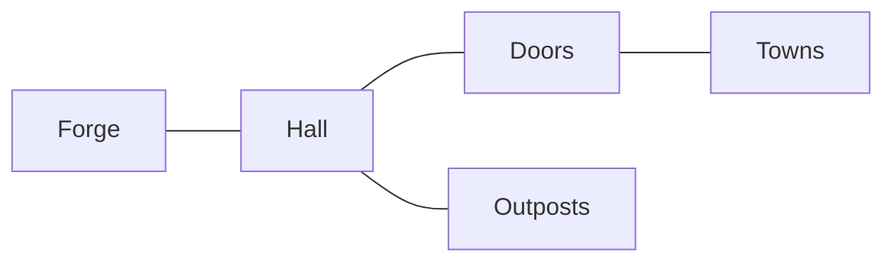

# Lore: the Hall and its keepers

*[`data/team/dwarves.yaml`](../data/team/dwarves.yaml) is the one source for each keeper's name, kind, title, role, voice and disclosure; [`data/regions/*.yaml`](../data/regions/) for the regions. This file explains their world; the YAML wins.*

## The Hall

*The founders' community as a forge-kingdom in the Front Range: bright and golden, never a dungeon. Halls, forges, molten gold, bronze doors, gnome clockwork and lifts, a warm heart safe and contained; outside, plains and peaks. Looks: [the vocabulary](../art/DIRECTION.md#the-vocabulary-of-the-hall).*

| Room | What happens there |
| --- | --- |
| [The Great Hall of the Community](https://coloradostartups.org/community/) | Inside the doors, founders meet people already building |
| [The Map Room](https://coloradostartups.org/ecosystem-canvas/) | Startup Resources, charted for every stage |
| [The Leaderboard gallery](https://coloradostartups.org/leaderboard/) | Colorado companies, sources checked |
| [The forge](https://coloradostartups.org/team/) | Deepest in the mountain: Paul and the keepers |

*Founders are its heart; talent, capital and service providers are welcome too.*

## The three outposts

*A person organizes each outpost; the keepers never do. The towns are real.*

| Outpost | Towns |
| --- | --- |
| [Photon Mountain](../data/regions/photon-mountain.yaml) | Boulder under the Flatirons, Golden on Clear Creek, Arvada, and Denver's city lights on the plain |
| [Space Peak](../data/regions/space-peak.yaml) | Colorado Springs and Manitou Springs, under Pikes Peak |
| [Fusion Canyon](../data/regions/fusion-canyon.yaml) | Old Town Fort Collins by the Poudre, Loveland, Windsor, Greeley. Named for the canyon, built on the plain |

## Outside the doors: the towns

*The doors open onto real towns (decision 90) and a town square, where founders meet neighbors, trade help and set out again.*

| Rule | What it means |
| --- | --- |
| They look like Colorado | Main streets, cottages, headframes, windpumps, footbridges and aspens, as [the vocabulary](../art/DIRECTION.md#the-vocabulary-of-the-hall) paints them |
| The townsfolk | Founders and neighbors. Dwarves and gnomes visit from the Hall; each keeper keeps its one job |
| People, not scores | No points, levels or ranks for people. The Leaderboard ranks companies, from verified data (decision 6) |

## The keepers

*Dwarves are the stonecutters and smiths; gnomes, the tinkerers who build lanterns, lifts and map engines. Three are keepers, each an AI agent.*

| Keeper | Kind | Job |
| --- | --- | --- |
| [Communitas, Keeper of the Doors](../data/team/dwarves.yaml#L11) | Dwarf | Meets every newcomer and points them to the right room |
| [Resourcus, Keeper of the Canvas](../data/team/dwarves.yaml#L45) | Gnome | Tinkers in the Map Room; answers from Startup Resources, citing only the map |
| [Publicus, Herald of the Hall](../data/team/dwarves.yaml#L76) | Dwarf | Drafts the Hall's news for people to review and publish |

*Colorado Startups runs each, and each says so wherever it appears. Helpers, not authorities: a person reviews their work. They point to people and resources; they never speak for the community or moderate.*

## Made here, borrowed from no one

*The look is original: Front Range stone, Colorado mining heritage, forge light, the folk's own costumes and tools. It borrows no name, character, design, rune, font or reference picture from any game or film; the gate enforces names. Places that matter to the Ute and other tribes, such as Garden of the Gods, are never fantasy decoration ([rules](../art/direction/look.md)).*
