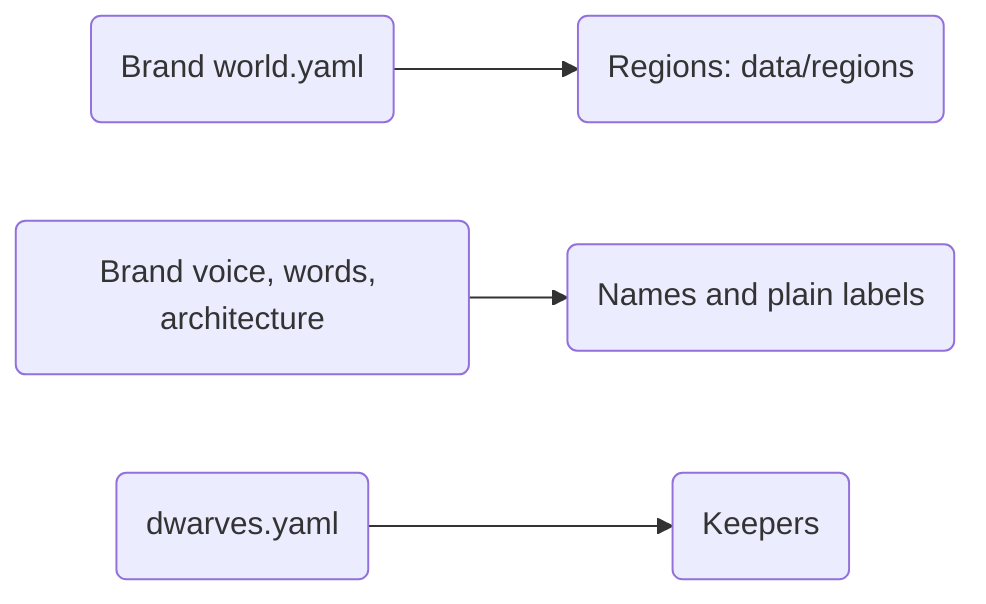

# Lore: the world on this site

*Brand owns the world, and wins wherever this file differs ([brand decision 6](https://github.com/Colorado-Startups/brand/blob/main/decisions.md), "One home"). This file maps it onto the site: the regions and who the keepers are. There is no single Hall and no rooms: Colorado Startups is its real places (Paul, 2026-11-15, "Drop the Hall"). [`dwarves.yaml`](../data/team/dwarves.yaml) is the one source for each keeper, and brand defers to it. The art side and the site rules: [`art/DIRECTION.md`](../art/DIRECTION.md).*

## Owned by brand

| Topic | Brand source |
| --- | --- |
| Places, peoples, creatures and machines: towns, regions, real places, characters | [data/world.yaml](https://github.com/Colorado-Startups/brand/blob/main/data/world.yaml) |
| Voice, tone, keeper voices, vocabulary | [data/voice.yaml](https://github.com/Colorado-Startups/brand/blob/main/data/voice.yaml) |
| Banned words and AI tells | [data/words.yaml](https://github.com/Colorado-Startups/brand/blob/main/data/words.yaml) |
| Naming, lockups and the brand tree | [data/architecture.yaml](https://github.com/Colorado-Startups/brand/blob/main/data/architecture.yaml) |
| Audiences | [data/strategy.yaml](https://github.com/Colorado-Startups/brand/blob/main/data/strategy.yaml) |

## The outposts

| Outpost, from world.yaml `outposts` | Site data |
| --- | --- |
| Photon Mountain | [`photon-mountain.yaml`](../data/regions/photon-mountain.yaml) |
| Space Peak | [`space-peak.yaml`](../data/regions/space-peak.yaml) |
| Fusion Canyon | [`fusion-canyon.yaml`](../data/regions/fusion-canyon.yaml) |

## The keepers

| Keeper | Kind | Job |
| --- | --- | --- |
| [Communitas, Keeper of the Doors](../data/team/dwarves.yaml#L11) | Dwarf | Meets every newcomer and points them to the right place |
| [Resourcus, Keeper of Startup Resources](../data/team/dwarves.yaml#L45) | Gnome | Answers from Startup Resources, citing only the map |
| [Publicus, Herald of Colorado Startups](../data/team/dwarves.yaml#L76) | Dwarf | Drafts the news for people to review and publish |

*Each is an AI agent run by Colorado Startups, and says so wherever it appears ([surfaces](../.claude/rules/ai-disclosure.md)). Helpers, not authorities: a person reviews their work and organizes each outpost. They point to people and resources; they never speak for the community or moderate.*
