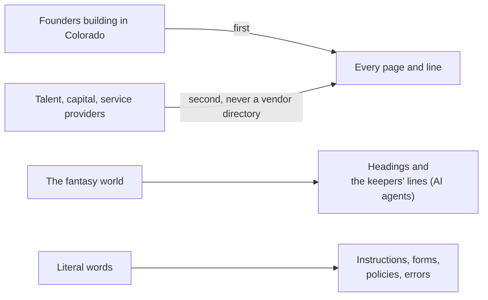

# Voice: how the site writes

**Precedence.** This restates `~/.claude/rules/writing-and-gates.md` and the voice card in Colorado Startups' private LinkedIn project. If they disagree with this file, they win; fix this file in the same session.

## The voice

1. **Kind, clear, simple, accurate.** The Colorado Startups house voice.
2. **Answer first.** The first line carries the point.
3. **Short sentences.** One idea each; split anything past about 30 words.
4. **One specific thing.** A named company, person, city or sourced number beats a general claim.
5. **Warm, never gushing.** Contractions, plain verbs, at most one exclamation mark on a page.
6. **The community's own words.** Paul calls the community "Startupers". "The future is bright 🔆" closes big moments only.

## Mechanics

| Rule | Gate | Rule id |
| --- | --- | --- |
| No em dashes and no spaced en dashes. | The gate blocks both. | [`em-dash`, `spaced-en-dash`](../04_tools/cs_site_rules.json) |
| No hedging and no AI tells (the house list). | The gate warns on them. | [`hedge-word`, `ai-tell`](../04_tools/cs_site_rules.json) |
| Every figure carries its source or the word "goal" in the same sentence. | The gate warns on bare figures. | [`unattributed-figure`](../04_tools/cs_site_rules.json) |

- Write "Colorado", not "CO".
- UI copy: sentence case; buttons say exactly what happens ("Join the Slack", "Ask Resourcus", "Nominate a company"); errors say what went wrong and how to fix it, without apology.

## Who we write for

Founders building companies in Colorado come first in every page and line. The wider startup community (talent, capital and service providers) is welcome; write to them second, and never let a page read as a vendor directory.

## The fantasy world, used lightly

There is no single hall (Paul, 2026-11-15: "There's multiple places that people are"). Colorado Startups is its real places: Boulder, Golden, Denver, Colorado Springs and Fort Collins, painted as a fantasy Colorado, in three regions. Say "Colorado Startups" or name the place. Use the world's flavor in headings and the keepers' lines. Keep instructions, forms, policies and errors literal: nobody should have to decode a metaphor to subscribe or nominate a company.

## Never

- Political or election content, fund talk, the transition's terms, or the avoid list in the site brief's section 2 (private archive).
- Franchise names or anything that imitates a game or film franchise.
- Unattributed member counts.
