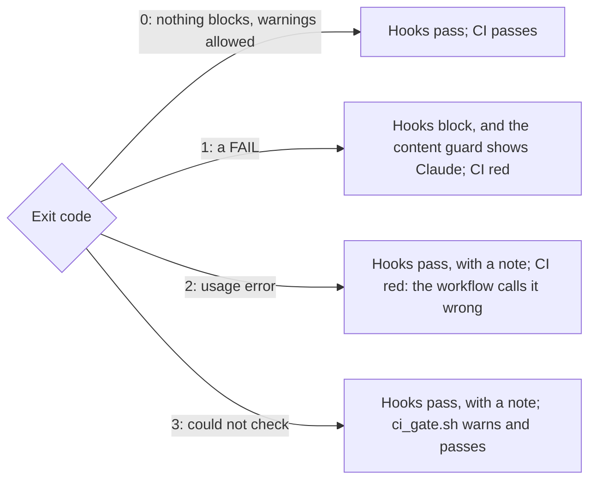

# 04_tools: content and git gates

*House rules, then `cs_site_rules.json`, win over this file. Which gate fires: [`site-gates.md`](../.claude/rules/site-gates.md) (C5, C8). Options: each script's header.*

## Checkers

| Checker | Run | Exits | Guards |
| --- | --- | --- | --- |
| [`cs_site_lint.py`](cs_site_lint.py) | `python3 04_tools/cs_site_lint.py [FILE...]`, `--built site/dist` | contract | Site words and dates; the one definition every call site runs |
| [`voice_lint.py`](voice_lint.py) | `python3 04_tools/voice_lint.py FILE` | contract | Prose. Vendored verbatim from `SoulCraft-Org/git-crafter` `tools/voice_lint.py`, whose commit its first lines name; never edited |
| [`contract_test.py`](contract_test.py) | `python3 04_tools/contract_test.py` | contract | Rules, settings, hooks, workflows and gate table agree |
| [`hook_selftest.sh`](hook_selftest.sh) | `bash 04_tools/hook_selftest.sh` | contract | Hooks block a bad file and a push to `main`; pre-push runs no `npm` |
| [`ci_gate.sh`](ci_gate.sh) | `bash 04_tools/ci_gate.sh npm run lint:built` | 3 becomes a warning | Runs one checker in CI; routes, never decides |
| [`ci_runner.sh`](ci_runner.sh) | `CI_RUNNER` in `site-tests.yml`, `e2e.yml` | contract; 1 for arm, larger or self-hosted | The `runs-on` label |
| [`secret_scan.sh`](secret_scan.sh) | `secret-scan.yml` | 0, 1, 2; 4 broken scanner, never 3 | Pinned gitleaks over a run's commits; never in `ci_gate.sh` |
| [`deploy_gate.sh`](deploy_gate.sh), vendored from Git Crafter | `deploy-gate.yml` | 0 moved or waiting; 1 refused; 2; 3 red | Fast-forwards `production` after `site-tests` and `secret-scan` pass; an outside commit soaks first |
| [`merge_policy.py`](merge_policy.py) (vendored from Git Crafter), [`.json`](merge_policy.json), [`fixtures`](merge_policy_fixtures/) | `--pr N --sha <head>` | 0 mergeable; 1 not; 2; 3 | Outside PRs, on since 2026-11-12. Every path `ai_mergeable`, none `maintainer_only` |
| [`export_public.py`](export_public.py), [`export_manifest.json`](export_manifest.json) | `--check`, `--out DIR`, `--self-test` | 0; 1 unlisted or clash; 2; 3 | Public repo (#552): every path matches a rule with a reason |
| [`export_scan.py`](export_scan.py) | `export-dry-run.yml`, with gitleaks | 0, 1, 3 | Emails, phones, names, keys, private links in an exported tree |
| [`package_age.py`](package_age.py) | `dependency-age.yml` | contract | New lockfile versions: from npm, 14 days old (7 for a fix; decisions 12, 89) |
| [`gitleaks_allow.py`](gitleaks_allow.py), [`.json`](gitleaks_allow.json) | `secret-scan.yml`: the tree and `--range BASE..HEAD`; `--self-test` | contract | gitleaks' allow marker only on listed lines, in the tree and on lines a run's commits add (#774); a PR is judged by the base commit's list |

## Exit contract

Could not verify is not verified, so 2 and 3 never block a commit.

Rules data, how to change a rule, and its known limit: [`RULES.md`](RULES.md).
