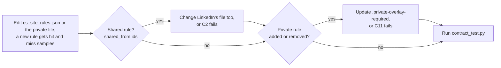

# 04_tools rules data

*House rules, then `cs_site_rules.json`, win over this file. The checkers and the exit contract: [`README.md`](README.md).*

## Files

| File | Holds |
| --- | --- |
| [`cs_site_rules.json`](cs_site_rules.json) | Scope, grades, term rules with samples, date windows, rules shared with LinkedIn |
| `cs_site_rules.private.json` (archive only) | The private avoid list (20 term rules), never exported (#552); `CS_SITE_PRIVATE_RULES` names another path. Without it, 10 public rules run and C11 skips |
| `.private-overlay-required` (archive only) | Marks the archive (#624, #667): the overlay must load with its minimums and `required_ids`. Missing: lint 3, C11 FAIL |

## Changing a rule

Known limit (#667): deleting the overlay and its marker together looks like a public clone. Only review catches it: both are `maintainer_only`, and CODEOWNERS covers `04_tools/`. A check would be one more file to delete with them.
