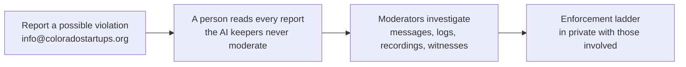

# Code of conduct

This project adopts the [Contributor Covenant 3.0](https://www.contributor-covenant.org/version/3/0/), its newest version (released 2025-07-28). Its text rules; these tables summarize it.

| Where | Which rules |
| --- | --- |
| This repo, its issues, pull requests and Discussions | The Contributor Covenant 3.0 |
| The Slack and the LinkedIn Group | The community's [Code of Conduct](https://coloradostartups.org/code-of-conduct/) |

## Pledge and behaviors

We pledge a welcoming, safe and equitable community for all, whatever their identity, background or status. Everyone acting in good faith gets the same privileges.

| Encouraged | Restricted |
| --- | --- |
| Respect the community's **purpose** and ways of gathering | **Harassment**: ignoring stated boundaries or a request to stop |
| Engage **kindly and honestly** | **Character attacks**: insulting or demeaning comments |
| Respect **different viewpoints** | **Stereotyping or discrimination** by identity or trait |
| **Take responsibility** for your actions | **Sexualization**: inappropriate intimacy for the context |
| Give and accept **constructive feedback** | **Violating confidentiality**: sharing private information without permission |
| Commit to **repairing harm** | **Endangerment**: causing, encouraging or threatening harm |
| Sustain the community's **well-being** | Other ways that **threaten its well-being** |

Instances, threats and promotion of these all violate this code. Also restricted: **misleading identity**, **failing to credit sources**, off-norm **promotional material**, and **irresponsible communication** of restricted content.

## Reporting

| Promise | Detail |
| --- | --- |
| Privacy | The reporter's identity stays private |
| Speed | Report promptly; moderators respond in a timely manner |
| Openness | As transparent as safety and confidentiality allow; telling the community can be part of an agreed resolution |
| Security | Through [`SECURITY.md`](SECURITY.md), never a public issue |
| Who | The maintainers in [`MAINTAINERS.md`](MAINTAINERS.md) are the Community Moderators and Managers. Every one is a person |

Not every conflict is a violation.

## Enforcement ladder

Moderators pick a rung by the harm done; severe violations skip rungs. The ladder guides Community Managers' judgment without limiting it.

| Rung | Event | Consequence | Repair |
| --- | --- | --- | --- |
| 1. Warning | One incident or a series | Private written warning | Apology, owning it, clarifying expectations |
| 2. Temporarily limited activities | A repeat after a warning, or a first serious violation | Warning plus a time-limited cooldown, maybe per channel or person | Apology, reflection, careful return |
| 3. Temporary suspension | A pattern warnings did not fix, or one serious violation | Written warning with conditions for return | Meet the conditions, return carefully |
| 4. Permanent ban | A pattern no rung resolved, or a violation that leaves the community unsafe | Removed from every space, tool and channel; rare, with strong reasons | None possible |

## Scope

All community spaces, plus official representation: an official email or social account, or an appointed role at any event.

## Attribution

Adapted from the [Contributor Covenant 3.0](https://www.contributor-covenant.org/version/3/0/), stewarded by the Organization for Ethical Source under [CC BY-SA 4.0](https://creativecommons.org/licenses/by-sa/4.0/); this summary keeps that license. [FAQ](https://www.contributor-covenant.org/faq), [translations](https://www.contributor-covenant.org/translations) and [resources](https://www.contributor-covenant.org/resources). The ladder was inspired by [Mozilla's code of conduct team](https://github.com/mozilla/inclusion).
