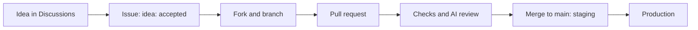

# Contributing

Thank you for helping. Every contributor follows the same path.



## 1. Start with an idea

| You have | Do |
| --- | --- |
| An idea | Open a [Discussion in Ideas](https://github.com/Colorado-Startups/coloradostartups.org/discussions/categories/ideas). A maintainer turns an accepted one into an issue |
| A bug | Open an issue with the bug form |
| A security problem | [`SECURITY.md`](SECURITY.md); never a public issue |
| Time to help now | Pick a [`good first issue`](https://github.com/Colorado-Startups/coloradostartups.org/labels/good%20first%20issue) |

## 2. Run the site

```bash
git clone https://github.com/<you>/coloradostartups.org
cd coloradostartups.org
npm install
git config core.hooksPath .githooks
npm run dev
```

The Team page shows fake people from `data/fixtures/team/`. The real Team data lives in private storage that only deploy builds read; never add personal data here.

## 3. Make the change

| Rule | Why |
| --- | --- |
| One change per pull request, with a test for code | Small PRs review fast |
| `npm run check:push` passes before you push | CI runs the same |
| The hooks pass; never `--no-verify` | They run the content gate and the secret scan |
| Sign off each commit: `git commit -s` | The DCO check requires it |
| Your contribution goes out on the repo's terms: CC0 1.0, and code also 0BSD ([`README.md`](README.md#license)) | Inbound equals outbound, so everyone can use all of it |
| Add third-party work only with its license, and list it under the README's Exceptions | It is not ours to give away |
| No em dashes; short sentences; plain words | The site's voice |
| Say "contributor", never "volunteer", "paid" or "hiring", about a seat | The positions rule |
| Every AI keeper is named as an AI agent wherever it appears | Disclosure is required |
| No contact data, no names without consent | Privacy |

## 4. Review and merge

| Your PR changes | What happens |
| --- | --- |
| Only content on the [AI-mergeable list](04_tools/merge_policy.json): events, regions, resources, positions, dispatches, credits, fixtures | The orchestrator, an AI agent, merges it at the checked head SHA. The required checks and two AI reviews pass first |
| Anything else: code, styles, tests, dependencies, build and CI files, gates, Workers, team or legal data, art, these docs | The orchestrator rebuilds it with you as `Co-authored-by`. It links the new PR from yours |

Check your PR yourself: `python3 04_tools/merge_policy.py --base origin/main`. AI agents review and merge, but never approve a PR. A merge reaches staging first. A change with an outside commit soaks on staging before production.

## 5. Forks and CI

CI runs on a fork's PR after a maintainer approves the first run. A fork PR gets no secrets.
