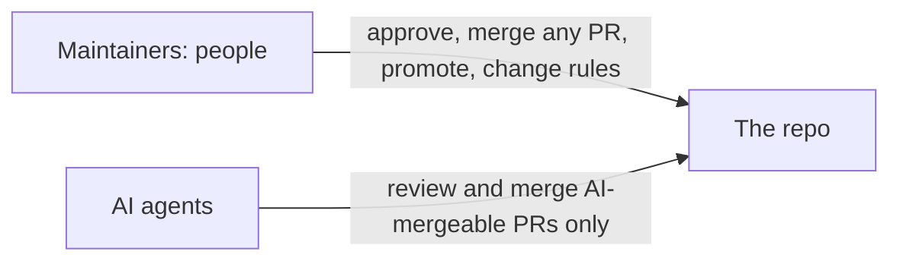

# Maintainers

| Maintainer | GitHub | Since | Can |
| --- | --- | --- | --- |
| Paul Foley, Founder & President | @paul-co-startups | 2026 | Everything: approve and merge any PR, promote to production, change these rules |

AI agents review and merge AI-mergeable PRs ([`04_tools/merge_policy.json`](04_tools/merge_policy.json)). They are not maintainers: they never approve a PR and never change the rules they follow.

To become one, see [`GOVERNANCE.md`](GOVERNANCE.md).
