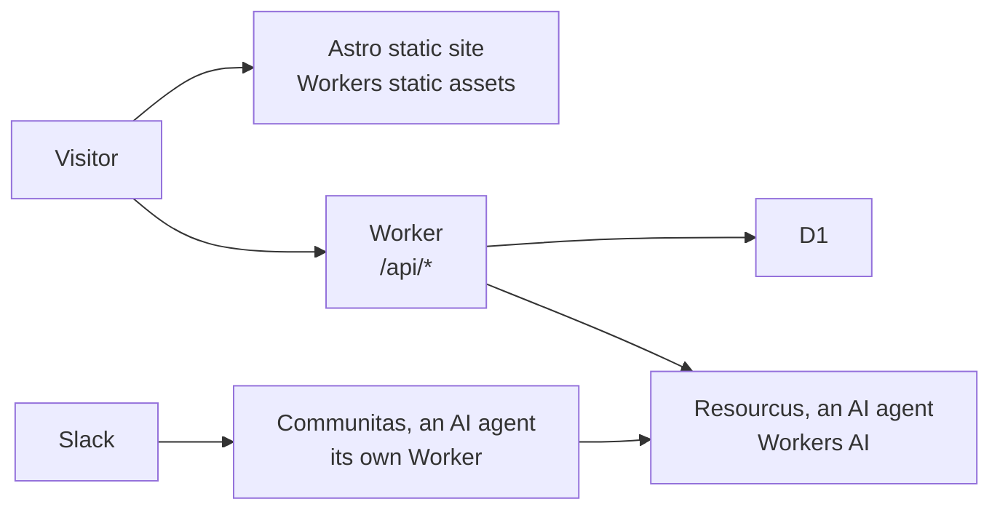

# coloradostartups.org

The [Colorado Startups](https://coloradostartups.org) website, for a community of entrepreneurs building companies in Colorado. Founders come first. It is built as "the Hall", a golden forge-kingdom carved into the Front Range. Anyone can improve it: see [`CONTRIBUTING.md`](CONTRIBUTING.md).

| Section | What | Content |
| --- | --- | --- |
| [Community](https://coloradostartups.org/community/) | The Slack, the LinkedIn Group and the newsletter | `site/src/pages/community/` |
| [Startup Resources](https://coloradostartups.org/ecosystem-canvas/) | The Ecosystem Canvas, the community's map of startup resources | `data/resources/` |
| [Leaderboard](https://coloradostartups.org/leaderboard/) | Colorado companies Colorado Startups recognizes | `data/leaderboard/` |
| [Regions](https://coloradostartups.org/regions/) | Photon Mountain, Space Peak and Fusion Canyon | `data/regions/` |
| [Team](https://coloradostartups.org/team/) | The people, the open positions, and three AI agents, the keepers | `data/team/` |



| Diagram node | Code |
| --- | --- |
| Astro static site | [`site/src/`](site/src/) |
| Worker | [`site/worker/`](site/worker/) |
| D1 | [`site/migrations/`](site/migrations/) |
| Resourcus | [`site/worker/resourcus/`](site/worker/resourcus/) |
| Communitas | [`workers/communitas/`](workers/communitas/) |

## Run it

```bash
npm install
git config core.hooksPath .githooks
npm run dev
```

| Command | Does |
| --- | --- |
| `npm run dev` | The site on your machine, with fake Team data (`data/fixtures/team/`) |
| `CS_PEOPLE_FIXTURES=1 npm run build` | A full build with the same fake Team data; without the variable a build refuses, so no deploy ships fake people |
| `npm run check:push` | Type check and the unit and Worker tests, as CI runs them |
| `npm run lint:selftest` | The content gate's own tests |

| File | Covers |
| --- | --- |
| [`LICENSE`](LICENSE) | CC0 1.0: everything Colorado Startups owns here, in the public domain |
| [`LICENSES/0BSD.txt`](LICENSES/0BSD.txt) | The second choice for code |
| [`SECURITY.md`](SECURITY.md) | How to report a vulnerability privately |
| [`GOVERNANCE.md`](GOVERNANCE.md), [`MAINTAINERS.md`](MAINTAINERS.md) | Who decides and who merges |
| [`ROADMAP.md`](ROADMAP.md) | Where ideas go and where to help |

## License

Use anything here for anything, except as the Exceptions below say. You need not ask, credit us or keep a notice.

| What | License |
| --- | --- |
| Everything Colorado Startups owns here: code, docs, data, the name, the logo, the Hall art, the keepers and `01_doctrine/` | [CC0 1.0](LICENSE) |
| Code, as you choose | `CC0-1.0 OR 0BSD`. [0BSD](LICENSES/0BSD.txt) is OSI-approved and asks for no notice |

CC0 waives no trademark or patent rights (its section 4(a)). We will not enforce ours against you.

### Exceptions

These are not Colorado Startups' to give away. Each keeps its own license.

| Thing | Where | Its license |
| --- | --- | --- |
| npm packages | `package.json`, `package-lock.json`; `npm install` downloads them | Each package's own |
| The web fonts, Alegreya Sans and Cinzel | The build downloads them (`site/astro.config.mjs`); the repo holds none | SIL Open Font License 1.1 |
| `04_tools/voice_lint.py` | Vendored from `SoulCraft-Org/git-crafter` | Apache 2.0 ([`LICENSES/Apache-2.0.txt`](LICENSES/Apache-2.0.txt)) |
| The Code of Conduct's Covenant text | [`CODE_OF_CONDUCT.md`](CODE_OF_CONDUCT.md) | CC BY-SA 4.0, from the Contributor Covenant |
| gitleaks, the secret scanner | CI downloads the release binary | MIT |
| Other companies' names and marks | `data/` | Theirs |
| The Hall art and clips made with AI models, and the Open Graph cards built from them | `art/`, `site/src/assets/art/`, `site/public/og/` | CC0 for our part. The model makers' terms still apply: [`art/LICENSES.md`](art/LICENSES.md) |

The model makers' terms set three duties for that art ([`art/licenses/duties.md`](art/licenses/duties.md)):

| Duty | Source |
| --- | --- |
| Never train a model or a LoRA on it | LTX Attachment A(18); Bria's Terms of Use (f) |
| Keep its watermarks and provenance metadata | LTX §6 and Attachment A(19); Bria's Terms of Use (i) |
| Label it as AI-made | LTX Attachment A(5) and §6 |

The older art was made with Anima, which is under the CircleStone Labs Non-Commercial License v1.2. That license limits running the model. Its §2(e) allows outputs for any purpose.
