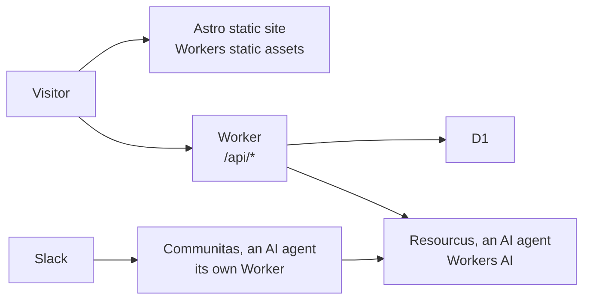

# coloradostartups.org

The [Colorado Startups](https://coloradostartups.org) website, for entrepreneurs building companies in Colorado. Founders come first. It is "the Hall", a golden forge-kingdom carved into the Front Range. Anyone can improve it: see [`CONTRIBUTING.md`](CONTRIBUTING.md).

| Scores | [Quality, Speed and Consumption](https://colorado-startups.github.io/coloradostartups.org/) · [Process maps](https://colorado-startups.github.io/coloradostartups.org/process.html) · [OpenSSF Scorecard](https://scorecard.dev/viewer/?uri=github.com/Colorado-Startups/coloradostartups.org) |
| --- | --- |

| Section | What | Content |
| --- | --- | --- |
| [Community](https://coloradostartups.org/community/) | The Slack, the LinkedIn Group, the newsletter | `site/src/pages/community/` |
| [Startup Resources](https://coloradostartups.org/ecosystem-canvas/) | The Ecosystem Canvas: the community's resource map | `data/resources/` |
| [Leaderboard](https://coloradostartups.org/leaderboard/) | Colorado companies we recognize | `data/leaderboard/` |
| [Regions](https://coloradostartups.org/regions/) | Photon Mountain, Space Peak, Fusion Canyon | `data/regions/` |
| [Team](https://coloradostartups.org/team/) | The people, open positions, and three AI agents, the keepers | `data/team/` |



| Node | Code |
| --- | --- |
| Astro static site | [`site/src/`](site/src/) |
| Worker | [`site/worker/`](site/worker/) |
| D1 | [`site/migrations/`](site/migrations/) |
| Resourcus | [`site/worker/resourcus/`](site/worker/resourcus/) |
| Communitas | [`workers/communitas/`](workers/communitas/) |

## Run it

```bash
npm install
git config core.hooksPath .githooks
npm run dev
```

| Command | Does |
| --- | --- |
| `npm run dev` | The site locally, on fake Team data (`data/fixtures/team/`) |
| `CS_PEOPLE_FIXTURES=1 npm run build` | Full build on fake data; without it a build refuses, so no deploy ships fake people |
| `npm run check:push` | Type check, unit and Worker tests, as CI runs them |
| `npm run lint:selftest` | The content gate's own tests |

| File | Covers |
| --- | --- |
| [`SECURITY.md`](SECURITY.md) | Reporting a vulnerability privately |
| [`GOVERNANCE.md`](GOVERNANCE.md), [`MAINTAINERS.md`](MAINTAINERS.md) | Who decides and who merges |
| [`ROADMAP.md`](ROADMAP.md) | Where ideas go and where to help |

## License

Use anything here for anything, except the Exceptions below. You need not ask, credit us or keep a notice.

| What | License |
| --- | --- |
| Everything we own here: code, docs, data, the name, the logo, the Hall art, the keepers, `01_doctrine/` | [CC0 1.0](LICENSE), in the public domain |
| Code, as you choose | `CC0-1.0 OR 0BSD`. [0BSD](LICENSES/0BSD.txt), the second choice, is OSI-approved and asks for no notice |

CC0 waives no trademark or patent rights (its section 4(a)). We will not enforce ours against you.

### Exceptions

Not ours to give away; each keeps its own license.

| Thing | Where | License |
| --- | --- | --- |
| npm packages | `package.json`, `package-lock.json`; `npm install` downloads them | Each package's own |
| Web fonts Alegreya Sans and Cinzel | The build downloads them (`site/astro.config.mjs`); the repo holds none | SIL Open Font License 1.1 |
| `04_tools/voice_lint.py` | Vendored from `SoulCraft-Org/git-crafter` | Apache 2.0 ([`LICENSES/Apache-2.0.txt`](LICENSES/Apache-2.0.txt)) |
| The Contributor Covenant summary | [`CODE_OF_CONDUCT.md`](CODE_OF_CONDUCT.md) | CC BY-SA 4.0 |
| gitleaks, the secret scanner | CI downloads the release binary | MIT |
| Other companies' names and marks | `data/` | Theirs |
| AI-made Hall art and clips, and Open Graph cards built from them | `art/`, `site/src/assets/art/`, `site/public/og/` | CC0 for our part; the model makers' terms still apply ([`art/LICENSES.md`](art/LICENSES.md)) |

Three duties follow ([`duties.md`](art/licenses/duties.md) cites each clause): never train a model or LoRA on the art, keep its watermarks and provenance metadata, and label it AI-made. Older art used Anima, whose CircleStone Labs Non-Commercial License v1.2 limits running the model; its §2(e) allows outputs for any purpose.
