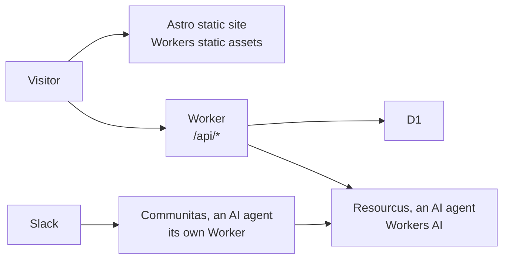

# coloradostartups.org

The [Colorado Startups](https://coloradostartups.org) website, for a community of entrepreneurs building companies in Colorado. Founders come first. It is built as "the Hall", a golden forge-kingdom carved into the Front Range. Anyone can improve it: see [`CONTRIBUTING.md`](CONTRIBUTING.md).

| Section | What | Content |
| --- | --- | --- |
| [Community](https://coloradostartups.org/community/) | The Slack, the LinkedIn Group and the newsletter | `site/src/pages/community/` |
| [Startup Resources](https://coloradostartups.org/ecosystem-canvas/) | The Ecosystem Canvas, the community's map of startup resources | `data/resources/` |
| [Leaderboard](https://coloradostartups.org/leaderboard/) | Colorado companies Colorado Startups recognizes | `data/leaderboard/` |
| [Regions](https://coloradostartups.org/regions/) | Photon Mountain, Space Peak and Fusion Canyon | `data/regions/` |
| [Team](https://coloradostartups.org/team/) | The people, the open positions, and three AI agents, the keepers | `data/team/` |



| Diagram node | Code |
| --- | --- |
| Astro static site | [`site/src/`](site/src/) |
| Worker | [`site/worker/`](site/worker/) |
| D1 | [`site/migrations/`](site/migrations/) |
| Resourcus | [`site/worker/resourcus/`](site/worker/resourcus/) |
| Communitas | [`workers/communitas/`](workers/communitas/) |

## Run it

```bash
npm install
git config core.hooksPath .githooks
npm run dev
```

| Command | Does |
| --- | --- |
| `npm run dev` | The site on your machine, with fake Team data (`data/fixtures/team/`) |
| `CS_PEOPLE_FIXTURES=1 npm run build` | A full build with the same fake Team data; without the variable a build refuses, so no deploy ships fake people |
| `npm run check:push` | Type check and the unit and Worker tests, as CI runs them |
| `npm run lint:selftest` | The content gate's own tests |

| File | Covers |
| --- | --- |
| [`LICENSE`](LICENSE) | MIT, for the source code only; not the name, logo, Hall art or keepers |
| [`TRADEMARKS.md`](TRADEMARKS.md) | The name, logo, Hall art and keepers: all rights reserved |
| [`SECURITY.md`](SECURITY.md) | How to report a vulnerability privately |
| [`GOVERNANCE.md`](GOVERNANCE.md), [`MAINTAINERS.md`](MAINTAINERS.md) | Who decides and who merges |
| [`ROADMAP.md`](ROADMAP.md) | Where ideas go and where to help |
