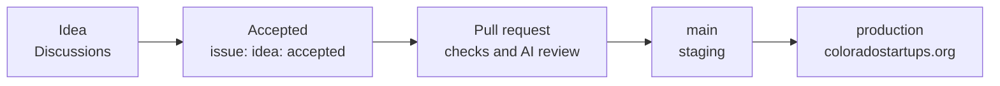

# Roadmap

The live site is [coloradostartups.org](https://coloradostartups.org). Ideas start in [Discussions](https://github.com/Colorado-Startups/coloradostartups.org/discussions/categories/ideas); an accepted idea becomes an issue labeled `idea: accepted`.

| Area | Lives in | Good first places to help |
| --- | --- | --- |
| Startup Resources (the Ecosystem Canvas) | `data/resources/`, `site/src/pages/ecosystem-canvas/` | A missing Colorado resource, a broken link |
| Events | `data/events/`, `site/src/pages/event-calendar.astro` | Calendar display and filters |
| Regions | `data/regions/`, `site/src/pages/regions/` | Region pages for Photon Mountain, Space Peak and Fusion Canyon |
| Accessibility and speed | `site/src/`, `site/e2e/` | Anything axe or a phone finds |

Issues labeled [`good first issue`](https://github.com/Colorado-Startups/coloradostartups.org/labels/good%20first%20issue) and [`help wanted`](https://github.com/Colorado-Startups/coloradostartups.org/labels/help%20wanted) are ready to pick up.
