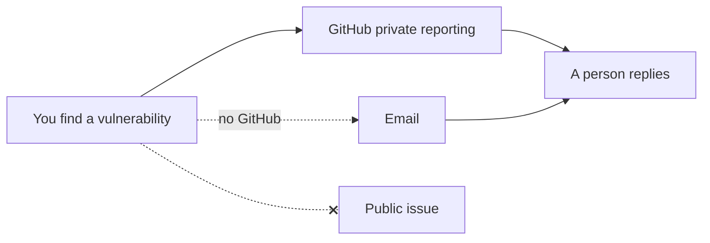

# Security

## Report a vulnerability

| Way | Use it for |
| --- | --- |
| [Report a vulnerability](https://github.com/Colorado-Startups/coloradostartups.org/security/advisories/new) (GitHub private reporting) | Anything in this code |
| Email info@coloradostartups.org | When you cannot use GitHub |

Please do not open a public issue. A person replies.

## How the site stays safe

| Control | Where |
| --- | --- |
| Static first: the Worker runs only for `/api/*` | [`site/wrangler.jsonc`](site/wrangler.jsonc) |
| One source for the security headers and CSP; no inline scripts | [`security-headers.ts`](site/worker/lib/security-headers.ts), [`_headers`](site/public/_headers) |
| Every form: rate limit, honeypot, timing check, schema, Turnstile | [`forms.ts`](site/worker/lib/forms.ts) |
| Resourcus, an AI agent: rate limit and Turnstile; retrieved text is data; no tools that change anything | [`site/worker/resourcus/`](site/worker/resourcus/) |
| Communitas, an AI agent: Slack signatures on every request; mentions stripped; user ids hashed | [`workers/communitas/src/`](workers/communitas/src/) |
| No Worker fetches a URL a visitor supplied | [`site/worker/`](site/worker/) |
| D1 holds inbound queues only, never an IP | [`site/migrations/`](site/migrations/) |
| Secrets live in Cloudflare, never in the repo; the hooks run a secret scan | [`.secretlintrc.json`](.secretlintrc.json), [`.githooks/`](.githooks/) |
| Fork PRs get no secrets; only deploy builds can read the Team data | [`scripts/people/overlay.mjs`](scripts/people/overlay.mjs) |
| AI agents may merge only allowlisted paths and never approve | [`04_tools/merge_policy.json`](04_tools/merge_policy.json), [`.claude/settings.json`](.claude/settings.json) |
