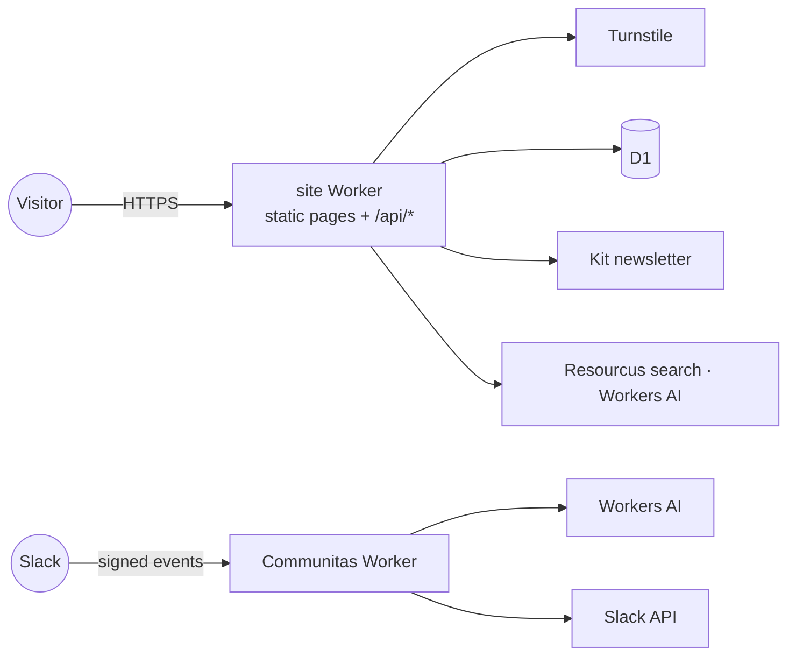

# Threat model

Covers the two Workers: `site/worker/` (coloradostartups.org) and `workers/communitas/` (the Slack app). Update it in the same PR as a change to either; the Quality page's `security.threat_model_current` checks that.

| Entry point | Asset at risk | Threat | Control (file) |
| --- | --- | --- | --- |
| Forms: `apply`, `nominate`, `suggest-resource`, `subscribe` | D1 rows, inboxes | spam, bots, injection | Turnstile (`lib/turnstile.ts`), rate limit (`lib/ratelimit.ts`), schema checks (`lib/validate.ts`) |
| `ask` (Resourcus) | Workers AI spend | cost run-up, prompt injection | rate limit, monthly model and search caps (`RESOURCUS_MONTHLY_*`) |
| `csp-report` | logs | log flooding | rate limit; body size check |
| Every page | visitors | XSS, framing, sniffing | CSP, HSTS, `X-Content-Type-Options`, `Referrer-Policy` (`lib/security-headers.ts`, `lib/csp.ts`) |
| Slack events (Communitas) | bot token, channels | forged requests, abuse | signing-secret check (`app.ts`), ask limit, pause switch (`pause.ts`), safety filter (`safety.ts`) |
| Secrets | Kit, Slack, Turnstile keys | leak | Wrangler secrets only; gitleaks and push protection; fork PRs get no secrets |
| Team data | people's names and photos | leak into the public repo | private R2 read at build time; fixtures in `data/fixtures/team/`; leak scan (`04_tools/export_scan.py`) |
| CI | the `production` branch | a hostile PR deploys | required checks; outside commits soak 30 minutes on staging (`04_tools/deploy_gate.sh`); actions pinned by SHA |

| Out of scope | Why |
| --- | --- |
| Cloudflare and GitHub platforms | their own programs |
| Visitor devices | not ours |

Report a vulnerability privately: [SECURITY.md](SECURITY.md).
