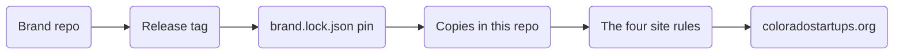

# Art direction: brand's, applied here

*Brand owns the art and the world, and wins wherever this file differs ([brand decision 6](https://github.com/Colorado-Startups/brand/blob/main/decisions.md), "One home"). The site keeps only the four rules it enforces. Model routes and duties: [`LICENSES.md`](LICENSES.md). The lore side: [`lore.md`](../01_doctrine/lore.md).*

## Site rules

| Rule | Enforced by | Status, 2026-11-14 |
| --- | --- | --- |
| Every keeper (Communitas, Resourcus, Publicus) is disclosed as an AI agent wherever it appears, in words or a picture. | The surfaces in [`ai-disclosure.md`](../.claude/rules/ai-disclosure.md); PR review. | In force |
| No franchise word in site text or alt text. | The `franchise-name` gate in [`cs_site_rules.json`](../04_tools/cs_site_rules.json), on `data/**`, `art/**` and the built site. | In force |
| Image credits and the AI-made label live in each image's metadata, plus a `/credits/` page. | Brand writes the metadata ([decision 45](https://github.com/Colorado-Startups/brand/blob/main/decisions.md)); the site's [duties](licenses/duties.md). | No `/credits/` page on `main` at `2879a77` |
| Art comes only from brand releases, pinned in `brand.lock.json`. | `npm run brand:check` (`scripts/brand/pull.mjs --check`) in `check:push` ([brand decision 10](https://github.com/Colorado-Startups/brand/blob/main/decisions.md)). | Lands with PR #27 |

## Owned by brand

| Topic | Brand source |
| --- | --- |
| The look: style, composition, palette | [art/DIRECTION.md](https://github.com/Colorado-Startups/brand/blob/main/art/DIRECTION.md) and [art/direction/](https://github.com/Colorado-Startups/brand/tree/main/art/direction) |
| The five place paintings | [dist/places/](https://github.com/Colorado-Startups/brand/tree/main/dist/places) |
| Keeper look sheets | [art/keepers/](https://github.com/Colorado-Startups/brand/tree/main/art/keepers) |
| FIBO 2.0 prompts | [art/prompts/](https://github.com/Colorado-Startups/brand/tree/main/art/prompts) |
| Video (LTX-2.5) and image motion (Rive) | [art/motion.md](https://github.com/Colorado-Startups/brand/blob/main/art/motion.md) |
| Decisions 37 to 46, in [decisions.md](https://github.com/Colorado-Startups/brand/blob/main/decisions.md) | FIBO 2.0 for all art (37). Brand's own rules deleted (38, 44). Borrow and blend (39, 40). Renders (41, 42). A bright, painted fantasy-game style (43, 44). Shipped (45). No taglines (46). |

## The vocabulary of the Hall

*Places, peoples, creatures and machines, by section of brand [data/world.yaml](https://github.com/Colorado-Startups/brand/blob/main/data/world.yaml). `scripts/artifacts/guides.mjs` renders this table into the site's brand guide, so keep the heading and the table.*

| Element | Section of world.yaml |
| --- | --- |
| Hall rooms, inside and outside the doors | `rooms` |
| Halls, metalwork, workshops, stone | `materials` |
| Outposts and their towns | `outposts`, `towns` |
| The five place paintings and their photo credits | `place_art` |
| Keepers and project characters | `keepers`, `characters` |
| Style influences | `influences` |
| Real places | `real_places` |
