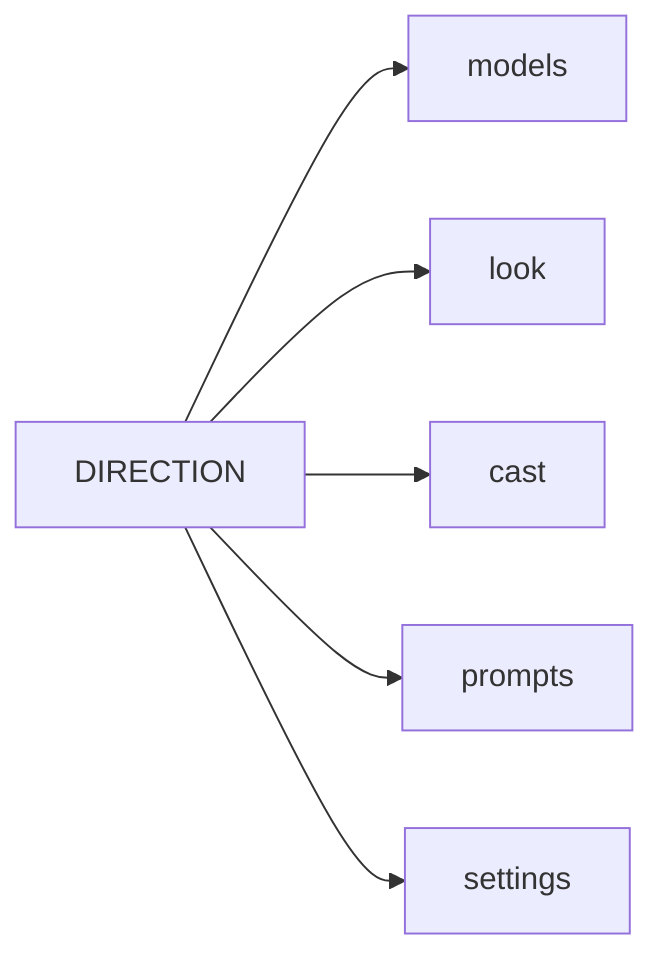

# Art direction v3: the forge-kingdom of the Front Range

*Decisions [21](https://github.com/Colorado-Startups/coloradostartups-site/blob/25a00d88d28a9a0895ac1e57d58e2ef4d21e6d09/00_project_system/decisions.md#L30), 28, 29, [43](https://github.com/Colorado-Startups/coloradostartups-site/blob/25a00d88d28a9a0895ac1e57d58e2ef4d21e6d09/00_project_system/decisions.md#L74), 45, 47, 48 and 88 win; fix this file in the same session. Routes: [`LICENSES.md`](LICENSES.md); keepers: [`dwarves.yaml`](../data/team/dwarves.yaml); hex: [`brand_tokens.yaml`](../01_doctrine/brand_tokens.yaml). v3 by L7, 2026-10-18; v2 and Anima: [`96d3182`](https://github.com/Colorado-Startups/coloradostartups-site/blob/96d318267713b22ab4a71edde451353ecb4def50/art/DIRECTION.md).*

| Part | Holds |
| --- | --- |
| [Models and motion](direction/models.md) | The template per job; LTX-2.5 clip rules. |
| [The rules and palette](direction/look.md) | Eight rules; each token's place. |
| [The keepers and regions](direction/cast.md) | Color anchors, props, crops, the 64 px goal; the three scenes. |
| [FIBO 2.0 prompts](direction/fibo-prompts.md) | The VGL caption template |
| [Settings and files](direction/settings.md) | Sizes, edits, upscales, crops, tiles; where each file lives. |

## The vocabulary of the Hall

| Element | Looks like | Never |
| --- | --- | --- |
| Halls | Red sandstone and granite carved into soaring arches; timber beams; hammered bronze pillars. Halls cut from living rock, long stairs, stone bridges over lit channels. | A cave, a dungeon, a dark mine, a fortress wall. |
| Hearths and forges | Huge stone hearths, warm contained fire. | Smoke-black walls, hellish fire |
| Molten gold | Glowing floor channels behind brass rails, giving light. | Lava flows, danger |
| Doors | Tall hammered bronze doors with geometric relief, standing open in the cliff face. | Runes, inscriptions, locked gates |
| Banners | Gold, ember and sky blue; at most a plain mountain or sun shape. | Lettering, heraldry from any real house. |
| Gnome workshops | Brass clockwork, gears, orreries, telescopes, small cranes; cog railways, mine lifts and ore carts, after the Pikes Peak cog line. | Steam-punk grime, any game's machines or mounts. |
| The mountain's heart | The range's warmth under the Hall: hot springs and soft steam, as at Idaho Springs; glowing vents feed the forges, behind brass rails. | Eruptions, lava, a volcano crater, danger. |
| Mountain folk | Dwarves and gnomes only: hearty, cheerful, quick to share meals at long tables. | A folk of living rock, any game's creature. |
| Founders | Mixed ages and backgrounds in casual Colorado clothes, with laptops, sketches and prototypes. | Suits in a boardroom |
| Colorado | The Flatirons as three tilted slabs of reddish rock. Golden aspens, the Front Range skyline, alpenglow, Pikes Peak, plains towns. | Generic fantasy peaks, desert, mesas |
| Town main streets (decision [90](https://github.com/Colorado-Startups/coloradostartups-site/blob/25a00d88d28a9a0895ac1e57d58e2ef4d21e6d09/00_project_system/decisions.md#L191)) | Brick and timber false-front storefronts from Colorado's mining towns; awnings, hanging lanterns, the mountains close behind. | Any game's town, castle walls, a medieval market. |
| The town square | Aspens and benches around a stone fountain, a notice board of blank papers, founders and neighbors talking. | A quest giver, signs with lettering. |
| Cottages | Stone foundations, timber frames, steep roofs for snow, warm windows at golden hour. | Thatch fairy-tale huts, mushroom houses. |
| Plains and creeks | Windpumps near Fort Collins and Greeley; footbridges over Boulder Creek, Clear Creek and the Poudre; mine headframes on the hills. | Rope bridges over chasms, ruins |
| Real places | Shown as they are, warm and lit. | Fantasy decoration of places that matter to the Ute and other tribes, such as Garden of the Gods. |
