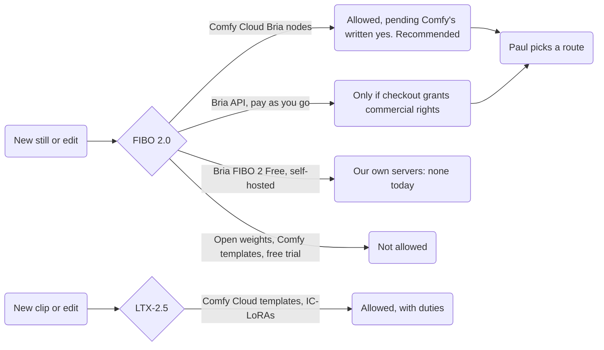

# Model licenses for the Hall's art

| Record | Detail |
| --- | --- |
| Written | L7, 2026-10-08. FIBO 2.0 and LTX-2.5 reviewed 2026-11-02 for decision [88](https://github.com/Colorado-Startups/coloradostartups-site/blob/25a00d88d28a9a0895ac1e57d58e2ef4d21e6d09/00_project_system/decisions.md#L183). |
| Scope | Every model or service touching the art has a row; no row means not used. |
| Precedence | Decision [28](https://github.com/Colorado-Startups/coloradostartups-site/blob/25a00d88d28a9a0895ac1e57d58e2ef4d21e6d09/00_project_system/decisions.md#L37) for Anima, 88 for FIBO 2.0 and LTX-2.5. Each [source](licenses/sources.md)'s license text wins over these summaries. A record for Paul, not legal advice. |
| Checked | Decision 88: read each license in full before any render. FIBO 2.0 and LTX-2.5 passed. "Not checked" rows await Paul's later review, set 2026-10-18. |
| Prompts | Plain language, negative prompts and FIBO's captions too: no franchise, character or artist names (decision [29](https://github.com/Colorado-Startups/coloradostartups-site/blob/25a00d88d28a9a0895ac1e57d58e2ef4d21e6d09/00_project_system/decisions.md#L38)). The content gate scans `art/**/*.md` and `art/**/*.txt`. |

## Verdict at a glance

| Model or service | Status | License | Outputs on the site | Attribution |
| --- | --- | --- | --- | --- |
| FIBO 2.0 (Bria). | Per route: [routes](licenses/fibo-routes.md), [reasoning](licenses/fibo-reasoning.md) | CC BY-NC 4.0 weights; Bria's terms and plans. | Bria nodes pending Comfy; open weights not allowed. | None stated |
| LTX-2.5 (Lightricks), IC-LoRAs. | **Allowed**, [with duties](licenses/ltx.md) | LTX-2.x Community License. | Allowed | None on outputs |
| Anima (CircleStone Labs), Comfy template `image_anima_base_v1`. | **Superseded for new work** (decision 88). Shipped art stays (decisions 28, 29). | CircleStone Labs Non-Commercial License v1.2, plus upstream ([detail](licenses/anima.md)). | Allowed: §2(e) | None for images; the footer's AI-generated line stays. |
| Comfy Cloud (comfy.org), Standard plan. | **In use** as the runner (decisions 28, 88). | Comfy Terms of Service, effective 2026-05-13. | Allowed: as between Comfy and us, we own Outputs. Bria's Terms of Use are silent on output ownership. | None |
| Krea 2 | Not used | Commercial use under $1M revenue (source: the Wave 0 L7 lane file, `4e31b7e`). | Allowed under its terms | AI-credit line |
| Workers AI `@cf/black-forest-labs/flux-1-schnell`. | Fallback only, not used | Apache-2.0 (same lane file). | Allowed | None |
| MiniMax H3 | **Banned** | Its license excludes the United States (same lane file). | Not allowed | n/a |
| Qwen-Image Edit; Qwen-Image. | **Dropped**; **not planned**: FIBO 2.0 makes edits and images (decision 88). | Not checked | n/a | n/a |
| An open-weight upscaler, a Comfy template. | **Planned** for 2x finals | Not checked; review deferred | Not checked | Not checked |
| Z-Image, with its upscaler. | **Not used** (Paul, 2026-10-18). | n/a | n/a | n/a |
| Comfy's graph `image_anima_base_v1`, in the archive's art workflows. | **Copied** as the published workflow's base. | Not checked; review deferred (decision [48](https://github.com/Colorado-Startups/coloradostartups-site/blob/25a00d88d28a9a0895ac1e57d58e2ef4d21e6d09/00_project_system/decisions.md#L79)). | n/a | Credited in the archive's workflow README. |

*Duties and Paul's billing question: [`duties.md`](licenses/duties.md).*
