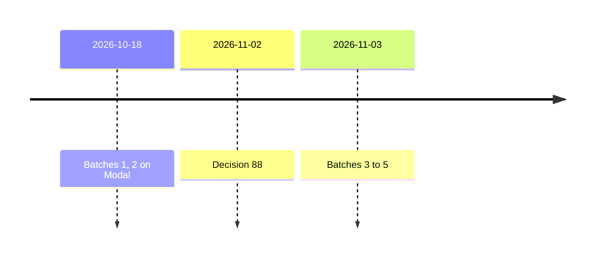

# Concepts for the v3 look

| What | Where |
| --- | --- |
| Style, palette and prompt system | [`art/DIRECTION.md`](../DIRECTION.md) |
| Each image's words; its seed and size. | [`art/prompts/<id>.txt`](../prompts/); the batch plans (private archive) |
| The requests; every run, in order. | batches 1 to 5 and the run log (private archive) |
| A 480 px preview per render | `batch-<n>/<id>.webp`, here |
| Which render ships as which file. | [`art/finals.json`](../finals.json), read by [`make-finals.mjs`](../tools/make-finals.mjs) |
| This record | L7 wrote the plan; L17 recorded the picks and the batch 2 run; all 2026-10-18. |
| The v2 sidecars (Gate A v2, 2026-10-08), retired with v3. | Commit `da82d0f`; their one run finding is in `LOG.md` |

## Status

| State | Item |
| --- | --- |
| Done | Batch 1: 18 images from `batch-1.json`, rendered by L14 (PR #31). The orchestrator picked; L17 made the shipped files. |
| Done | Batch 2: Fusion Canyon at three seeds, the stone and parchment tiles at three each, by L17. |
| Done | Decision 88 moves new stills to FIBO 2.0 and motion to LTX-2.5. Batches 1 and 2 are Anima's; their picks stand. |
| Open | `hero-b` waits for a slot. The 2x upscale of the hero, regions and keepers waits for an upscale workflow ([models](../direction/models.md)) |
| Done | Batch 3: 11 FIBO 2.0 stills from JSON captions ([prompts](../direction/fibo-prompts.md)), on Comfy Cloud's Bria node, by L6. They are the 404, founders forum and guides scenes ([scenes](scenes.md)). Route and 144-credit cap: Paul, in L6's chat; 133 credits spent (`LOG.md`). |
| Done | Batch 4: 6 Colorado-first stills of the founders forum and the guides, on Bria's Hugging Face Space at 0 credits, by L6. Their picks replace batch 3's for those two pages. |
| Done | Batch 5: the 404 passage, Colorado first (Pikes Peak granite, a cog railway), 5 stills on the Space at 0 credits, by L6. Its pick replaces batch 3's. |
| Rule | Content filters. Bria's node filters prompts and outputs in every new Bria plan; batch 3 ran with it off (`batch-3.plan.json`). Bria's Space has no filter, so a Space plan must set `moderation` to "none" and say why in `moderation_why` (`batch-4.plan.json`). A person views every take before it ships. |

| What batch 1 must answer | Answered in |
| --- | --- |
| 1. Is the look bright, warm and chunky enough, across a hero, a portrait and a region? | [Scenes](scenes.md), [keepers](keepers.md) |
| 2. Which keeper option reads best at a 64 px avatar (a goal) and at full size? | [Keepers at 64 px](keepers.md#keepers-at-64-px) |
| 3. Do the Flatirons, Pikes Peak and the plains read as Colorado? | [Scenes](scenes.md), Fusion Canyon re-rendered in batch 2. |
| 4. Are the tiles calm enough for quiet text backgrounds, despite the style line's rich detail? | [Texture tiles](tiles.md) |

| Ships as | Pick | Made |
| --- | --- | --- |
| `hero/hall.webp` | [`hero-a`](batch-1/hero-a.webp) | [Finals](finals.md) |
| `agents/communitas.webp`, `-small.webp` | [`keeper-communitas-3`](batch-1/keeper-communitas-3.webp) | Same |
| `agents/resourcus.webp`, `-small.webp` | [`keeper-resourcus-1`](batch-1/keeper-resourcus-1.webp) | Same |
| `agents/publicus.webp`, `-small.webp` | [`keeper-publicus-1`](batch-1/keeper-publicus-1.webp) | Same |
| `regions/photon-mountain.webp`, `space-peak.webp` | Batch 1, as rendered | Same |
| `regions/fusion-canyon.webp` | [`region-fusion-canyon-2`](batch-2/region-fusion-canyon-2.webp) | Same |
| `textures/night-stone.webp`, `stone.webp`, `parchment.webp` | `tile-night-stone`, `tile-stone-3`, `tile-parchment-3` | [Tiles](tiles.md) |
