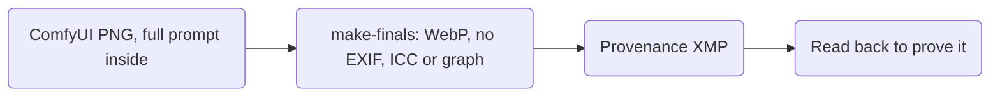

# Concepts: how the finals were made

*Part of the [v3 concepts record](README.md): batch 1 and batch 2 on Modal, 2026-10-18. Previews sit in `batch-<n>/` here.*

| Step | What |
| --- | --- |
| Keeper sizes | DIRECTION's goal sizes: 960 x 1200 for the large crop, 320 x 320 for the small one. The large crop scales up 9% from the render's 880 px width (source: the crops in `art/finals.json`). |
| Hero and region sizes | Rendered size, 1568 x 672 and 1360 x 768 (source: `art/prompts/sizes.json`). The 2x upscale workflow is not wired, and interpolation adds bytes, not detail. |
| Metadata | ComfyUI writes the full prompt into each PNG. make-finals writes WebP with no EXIF, ICC or ComfyUI graph, then its own provenance XMP (#656), and reads each file back to prove it. |
| Grounds | Two keeper picks sit in a painted circle on white, and Communitas sits on cream. The flat ground is 41% to 53% of each render (source: make-finals, 2026-10-18). |
| Ground fix | make-finals moves that ground to the `surface` token, so the three read as a set inside the gold Frame. It finds the ground by flood fill from the border, so white inside a painting (a beard, a blank page) keeps its color. |
| Glow | `site/src/components/art/keepers.ts` places each portrait's lantern glow on the light source in the pick. |

## Batch 2 run

| L17, once on Modal, with L14's pipeline (PR #31) | Figure |
| --- | --- |
| Cap and GPU | `--max-usd 2`; one L4, ComfyUI v0.41.0 (source: run log `run-1792351096.json`). |
| Planner estimate | $0.08 to $0.14, worst case $0.36 (source: the archive's Modal planner). |
| Time | ComfyUI ready in 21.1 s (source: run log). Each image took 29.2 to 43.2 s, the first the slowest. The container ran 307.3 s. |
| Cost | About $0.087 at Modal's published rates (source: run log). |
| `modal billing summary`, this month | Before, at 13:12 MDT: $0.35 metered, $0.34 credits, $0.00 billed (source: the reading). After, at 13:18 MDT: $0.46 metered, $0.45 credits, $0.00 billed (source: the reading). |
| Sizes | Every image came out at the size in its manifest (source: run log). |
