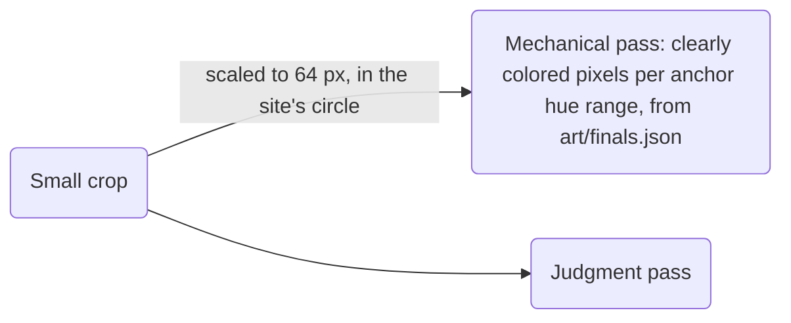

# Concepts: the keepers

*Part of the [v3 concepts record](README.md): batch 1 and batch 2 on Modal, 2026-10-18. Previews sit in `batch-<n>/` here.*

## Renders and picks

| Render (preview), batch 1 | What it shows | Verdict (orchestrator, 2026-10-18) | Ships as | Prompt |
| --- | --- | --- | --- | --- |
| [`keeper-communitas-1`](batch-1/keeper-communitas-1.webp) | Auburn double-braided beard, waving, lantern up, sky-blue cloak, bronze doors behind. | Not picked | | [txt](../prompts/keeper-communitas-1.txt) |
| [`keeper-communitas-2`](batch-1/keeper-communitas-2.webp) | Grandfatherly, silver beard, holding a door open, sky-blue tabard, ring of keys. | Not picked | | [txt](../prompts/keeper-communitas-2.txt) |
| [`keeper-communitas-3`](batch-1/keeper-communitas-3.webp) | A dwarf woman with copper-red braids, a lantern on a pole, keys and a sky-blue hooded cloak; open doors frame the mountains. | **Communitas** | `agents/communitas.webp`, `agents/communitas-small.webp` | [txt](../prompts/keeper-communitas-3.txt) |
| [`keeper-resourcus-1`](batch-1/keeper-resourcus-1.webp) | Elder gnome mapkeeper: white beard, goggles on a tall pointed brass hat, green coat, brass compass over a painted map. The clearest silhouette at small sizes. | **Resourcus** | `agents/resourcus.webp`, `agents/resourcus-small.webp` | [txt](../prompts/keeper-resourcus-1.txt) |
| [`keeper-resourcus-2`](batch-1/keeper-resourcus-2.webp) | Young gnome on a library ladder pinning markers on a wall map, with a clockwork shoulder arm. | Not picked | | [txt](../prompts/keeper-resourcus-2.txt) |
| [`keeper-resourcus-3`](batch-1/keeper-resourcus-3.webp) | A gnome woman cartographer with an astrolabe and lens over a map of the Front Range. | Out: its orange apron collides with Publicus's ember anchor. | | [txt](../prompts/keeper-resourcus-3.txt) |
| [`keeper-publicus-1`](batch-1/keeper-publicus-1.webp) | Copper-braided herald in a feathered cap and ember tabard, holding a blank broadsheet high in a print shop, with a satchel of scrolls. The most distinct silhouette of the three. | **Publicus** | `agents/publicus.webp`, `agents/publicus-small.webp` | [txt](../prompts/keeper-publicus-1.txt) |
| [`keeper-publicus-2`](batch-1/keeper-publicus-2.webp) | Bespectacled scribe-herald pulling a fresh sheet off a wooden press. | Not picked | | [txt](../prompts/keeper-publicus-2.txt) |
| [`keeper-publicus-3`](batch-1/keeper-publicus-3.webp) | A dwarf woman herald with a clockwork messenger bird on her arm, on a bannered balcony. | Not picked | | [txt](../prompts/keeper-publicus-3.txt) |

## Keepers at 64 px

Goal ([DIRECTION](../DIRECTION.md#the-keepers)): tell the keepers apart at 64 px by color anchor and prop. Two passes, as the house rules ask.

| Avatar | Sky blue | Pine | Ember | Judgment pass, at 64 px and 40 px, in color and grayscale: all three read apart. |
| --- | --- | --- | --- | --- |
| Communitas | **11%**, goal 8% | 1% | 53% | A round face with copper curls and sky-blue shoulders. Sky blue shows on no other keeper. |
| Resourcus | 1% | **5%**, goal 8% | 34% | By silhouette: the tall gold cone hat with goggles, and the white beard. His green is under the goal and shows on no other keeper. The coat is small at any crop: four crops measured 5% to 6% (source: make-finals). |
| Publicus | 0% | 0% | **33%**, goal 8% | A long red beard, red cap and feather above the ember tabard. Ember is not his alone: the Hall is warm, and Communitas's copper hair and wooden doors measure more. He is the warm keeper with no cool note. |
| Source | make-finals, 2026-10-18 | | | Hue ranges come from the art, not the tokens. Anima painted the sky-blue cloak teal, near 187 degrees, while the `community` token sits at 212. |

