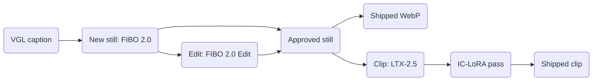

# Art direction: models and motion

*Part of [`DIRECTION.md`](../DIRECTION.md), art direction v3; [`LICENSES.md`](../LICENSES.md) says which route is allowed.*

## Models (decision [88](https://github.com/Colorado-Startups/coloradostartups-site/blob/25a00d88d28a9a0895ac1e57d58e2ef4d21e6d09/00_project_system/decisions.md#L183), 2026-11-02)

| Job | Model: Comfy Cloud template | Tier: spend | Status, 2026-11-02 |
| --- | --- | --- | --- |
| New still: hero, region, keeper or tile. | FIBO 2.0: `api_bria_fibo2_t2i`, a Bria node. | 3: 12.07 credits a run (source: Comfy Partner Node pricing). Ask with the estimate. | Blocked until Comfy confirms in writing and Paul picks a [route](../LICENSES.md#fibo-20-which-route-works-today). |
| Edit a still: hands, cleanup, one detail. | FIBO 2.0 Edit: `api_bria_image_edit`, a Bria node; a mask can limit the edit. | 3: the same | The same |
| Animate a still | LTX-2.5: `video_ltx2_5_i2v` | 2: GPU seconds from the plan's credits. | [License allows](../LICENSES.md#ltx-25-the-verdict); each run needs Paul's yes. |
| Loop a still | LTX-2.5: `video_ltx2_5_flf2v`, the same first and last frame. | 2: the same | The same |
| Refine a clip, or cut an alpha matte for an overlay. | IC-LoRA `ltx-2.5-22b-ic-lora-refine-details-1.0` or `ltx-2.5-22b-ic-lora-alpha-gen-0.9`, in a graph from `video_ltx2_5_i2v` | 2: the same | Graph not built |
| Upscale stills 2x | An open-weight upscaler: try `utility_seedvr2_3b_int8_upscale_image` first. | 2 | License not checked |
| Every Comfy Cloud run | Tiers: the Comfy section of `~/.claude/rules/compute.md` | No tier 2 budget is set. | Paul's yes in chat, with `comfy cloud status` before and after. |
| Any video on this Mac | None | None | Never: tier 1 ended on 2026-11-02 (`~/.claude/rules/compute.md`). |
| A FIBO 2.0 still on this Mac. | Comfy-Org int8 files | None | Blocked: no model runs here since 2026-11-02 (`~/.claude/rules/compute.md`). The files need 13.6 GB (source: Hugging Face file sizes, computed here); 6.3 GB is free (source: `diskutil info /`, 2026-11-02). The weights are non-commercial, so a company's test is clean only under a Bria license. The int8 files are untested on Apple silicon. |
| Source | Comfy Cloud's free discovery calls `search_templates`, `get_template_schema`, `get_node` and `search_models`, 2026-11-02. | | |

## LTX-2.5 motion

| Rule | What | Source |
| --- | --- | --- |
| Motion is an extra | Each clip starts from an approved FIBO 2.0 still, its poster. It plays only under `prefers-reduced-motion: no-preference`. `site/src` had no `<video>` on 2026-11-02. | `git grep` |
| Small motions | Lantern flicker, drifting embers, banners in a breeze, a keeper's wave. The camera holds or drifts slowly. No cuts. | |
| Limits | Frames % 8 == 1, such as 121; width and height divide by 32. | The LTX-2.5 model card. |
| Prompts | Plain sentences on what moves and what the camera does, in the Hall's vocabulary. | |
| Duties | Label clips AI-made and keep provenance. | [Duties](../licenses/duties.md); provenance for stills since #656 |

