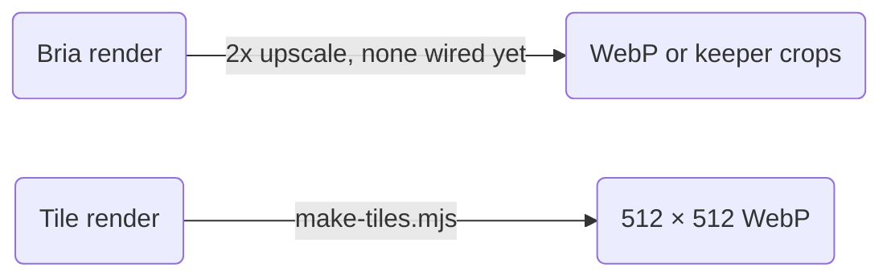

# Art direction: settings, files and components

*Part of [`DIRECTION.md`](../DIRECTION.md), art direction v3; [`LICENSES.md`](../LICENSES.md) says which route is allowed.*

## Settings, edits and upscales

| Kind | `aspect_ratio` | `resolution` | Delivered as |
| --- | --- | --- | --- |
| Hero | 21:9 | 1MP | 2x upscale, then WebP at 2400 px wide or more. |
| Region scene | 16:9 | 1MP or 4MP | 2x upscale, then WebP at 1920 px wide. |
| Keeper | 3:4 | 1MP or 4MP | 2x upscale, then the two crops. |
| Texture tile | 1:1 | 1MP | `art/tools/make-tiles.mjs`, then 512 × 512 WebP. |

| Setting | Rule | Source |
| --- | --- | --- |
| Sizes | Bria node sizes, above. Ratios beyond 16:9, 21:9 among them, render at 1MP only. | `get_node`, 2026-11-02 |
| 4MP price | Comfy's price list gives one price a run and does not say whether 4MP costs more. Estimate before a 4MP run. | Comfy's price list |
| Seeds | 1 or more. The same seed and `structured_prompt` recreate an image. | The node's tooltip |
| Edits | One imperative command, such as "Remove the extra finger from the founder's left hand". `guidance_scale` 3 to 5, `steps` 20 to 50. | The VGL guide's form; `get_node` |
| Upscales | None is wired on 2026-11-02, so finals ship at rendered size. With an upscaled source, point its `art/finals.json` entry at it and rerun `make-finals.mjs` | [How the finals were made](../concepts/finals.md) |
| Crops | Goal: the main subject inside the central 80% of the width, since boxes crop with `object-fit: cover`. `OtherSeats.astro` shows `hero/hall` at 16:9, its central 76% (source: the box ratios, computed here). | |
| First run, proposed | One hero and one keeper, checked against the shipped Anima art before any batch. That is 2 runs at 12.07 credits each. | Comfy Partner Node pricing |
| Texture tiles | Each is a 512 × 512 WebP that repeats with no visible seam. `stone` and `parchment` stay quiet, because body text sits on them. | Floors and ceilings: `brand_tokens.yaml`, block `texture`. Size goals: `TILES` in [`make-tiles.mjs`](../tools/make-tiles.mjs). |
| Night tile | `night-stone` renders as light granite and is mapped dark, so it never fights the shared "dark, night" negatives. | |

## Files and components

| Path | Holds |
| --- | --- |
| [`art/prompts/`](../prompts/) | The words, as `.txt` so the content gate scans them. |
| the archive's run folder | Batch requests and the run log (private) |
| [`art/concepts/`](../concepts/README.md) | Picks and previews per batch |
| [`art/finals.json`](../finals.json) | Which render ships as which file, for `make-finals.mjs` |
| the archive's workflow folder | The open workflow package (private) |
| [`art/og/cards.txt`](../og/cards.txt) | OG card copy |
| [`art/tools/trace-logo.mjs`](../tools/trace-logo.mjs) | The logo's SVG tracer |
| [`site/src/components/art/`](../../site/src/components/art/) | `ArtImage` and `Portrait`. `HeroArt`, `RegionArt`, `KeeperCard` and the seat pages render through them, so lookup, placeholders and idle motion have one definition. |

