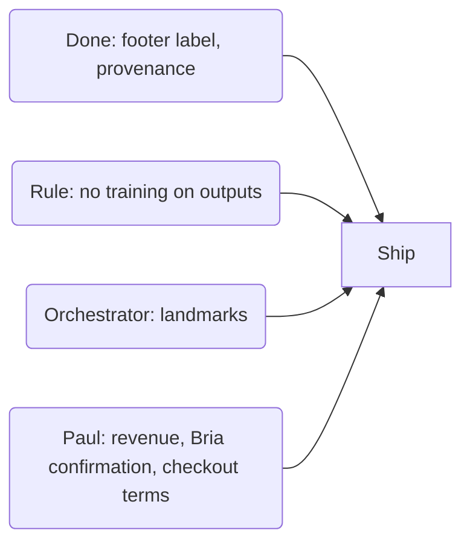

# Duties before anything ships, and the billing question

*Part of [`LICENSES.md`](../LICENSES.md). Read 2026-11-02. A record for Paul, not legal advice.*

## Duties before anything ships

| Duty | Source | What it means here | Status |
| --- | --- | --- | --- |
| Label AI-made art and video. | LTX Attachment A(5) and §6; the AUP. | The footer's `.ai-note` says "The Hall art is AI-generated." Scenes and clips need the same plain label. §6 also asks us to follow AI laws, such as California's AI Transparency Act. | Footer: done in #663 |
| Keep provenance | LTX §6 and Attachment A(19); Bria's Terms of Use (i). | LTX: keep watermarks, provenance metadata and latent disclosures. Bria: never remove the attribution, watermarks or metadata its technology embeds. `make-finals.mjs` writes each shipped WebP's provenance XMP (model, version, license, prompt, seed) and refuses a source carrying its maker's C2PA, EXIF or XMP. The site's image service writes it into every served variant (#668). | Done for the 13 shipped files (#656) |
| No training on outputs | LTX Attachment A(18), for commercial use; Bria's Terms of Use (f). | Never train a LoRA or model on them. | Rule |
| Revenue under $10M (source: LTX §2.1). | LTX §2.1 and §1.6. | Paul confirms once, then each year. | [Question for Paul](#billing-question-for-paul) |
| Landmark clearance | The AUP | [Row 8](ltx.md#the-reasoning-rows-6-to-8) | Orchestrator confirms |
| Hugging Face access forms | The LTX-2.5 and IC-LoRA repos are gated. | Needed only for a download; Comfy Cloud needs none. Accepting one is Paul's. | Not needed now |
| Written confirmation for the Bria nodes. | [Row 4](fibo-reasoning.md) | Comfy confirms that Standard plan subscribers may use FIBO 2.0 images commercially. | Draft in the archive's requests folder; Paul sends it. |
| Checkout terms for the Bria API. | [Row 5a](fibo-reasoning.md) | Read before the first pay-as-you-go call. | Only if Paul picks that route. |

## Billing question for Paul

*May FIBO 2.0 run on the Bria nodes, from the Standard plan's credits? Each route waits on one written check. Costs computed at 211 credits a dollar ([rate](fibo-routes.md)).*

| Route | Per image | A batch of 18, batch 1's size (the run log, private archive). |
| --- | --- | --- |
| Comfy Cloud's Bria nodes. **Recommended:** no new card, key or code. | 12.07 credits, about 6 cents. | About $1.03 (computed here, per the rate) |
| A Bria API account, cheaper per image. It needs Paul's card, code, and an API key only Paul may create (`~/.claude/rules/keys.md`); its checkout terms must grant commercial rights first. | $0.032 (source: bria.ai/pricing). | About $0.58 (computed here, per the source price) |

| Also for Paul | Answer needed |
| --- | --- |
| Is Colorado Startups, Ltd.'s annual revenue under $10M (source: LTX §2.1)? Count any company it controls or shares control with. | LTX-2.5 is free only below that line. Only Paul has this fact. |
| LTX-2.5 spend | None new: clips use GPU seconds from the same plan credits. Each run still waits for Paul's yes. |
