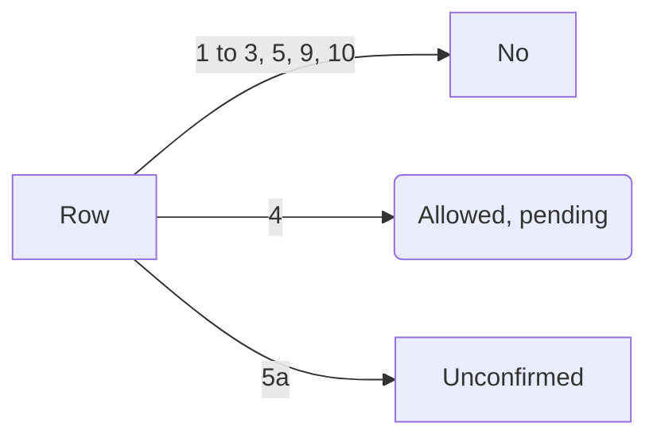

# FIBO 2.0: the reasoning

*Part of [`LICENSES.md`](../LICENSES.md); rows 6 to 8: [`ltx.md`](ltx.md#the-reasoning-rows-6-to-8); sources: [`sources.md`](sources.md). A record for Paul, not legal advice.*

| # | Question | The text says | Reading for Colorado Startups, Ltd. | Verdict |
| --- | --- | --- | --- | --- |
| 1 | Is site art from the FIBO 2.0 weights NonCommercial? | CC BY-NC §1(i): not primarily intended for or directed towards commercial advantage. §2(a)(1) licenses NonCommercial purposes only. | A for-profit company makes art for its own site and brand; a free site changes neither who uses the model nor why. | Commercial. **Not allowed** |
| 2 | Do the images escape the weights' license? | CC BY-NC says nothing about outputs. Bria's card and access form: commercial use "requires a separate commercial agreement with BRIA AI". | The limit is on using the model; no clause frees outputs as Anima's §2(e) does. | **No** |
| 3 | Do Comfy Cloud's open-weight FIBO templates change that? | comfy.org/cloud: "Every model on Comfy Cloud is cleared for commercial use." Comfy's Terms of Service grant nothing like it. The Comfy-Org repack card says commercial use needs a Bria agreement. | Binding terms and the weights' own card beat a marketing page. | **Not allowed** until Comfy confirms in writing. |
| 4 | Do Comfy Cloud's Bria nodes carry commercial rights? | Comfy's terms: Partner Node use follows the provider's terms. Its provider table lists Bria as verified, commercial use on Cloud confirmed, yet calls itself "not a finished reference", with "placeholders". Bria grants commercial rights to "active paid subscriptions or valid licensing agreements". | We hold a paid Comfy plan, not a Bria one. Comfy's written answer settles whether our use rides on its Bria agreement. | **Allowed, pending written confirmation** |
| 5 | Does Bria's free API trial work? | Bria's Terms of Use: the free right covers personal and non-commercial use only. | Site art is neither | **Not allowed** |
| 5a | Does Bria API pay as you go carry commercial rights? | Row 4's Bria grant; bria.ai/pricing lists pay as you go as a plan with no monthly fee. | It may or may not count as a paid subscription; the checkout terms settle it. | **Unconfirmed**: read the checkout terms first. |
| 9 | Does Bria's FIBO 2 Free plan cover Comfy Cloud? | It sits under "Self-hosted licenses", for "FIBO 2 on your own servers". After a cancel, "the model no longer downloads or starts on your servers". The FAQ: a license excludes the Bria API. | It licenses Bria's build on our servers, metered by our calls. Comfy Cloud is Comfy's servers, running the CC BY-NC repack. | **No**: neither the open-weight templates nor the Bria nodes. |
| 10 | Is there a self-hosted license for Edit Turbo? | Bria's plans page sells no FIBO 2 Turbo license. FIBO 2, "image generation and editing", is on sale. | Edit Turbo has no commercial license (2026-11-02); FIBO 2 Dev covers edits too. | **No** |
