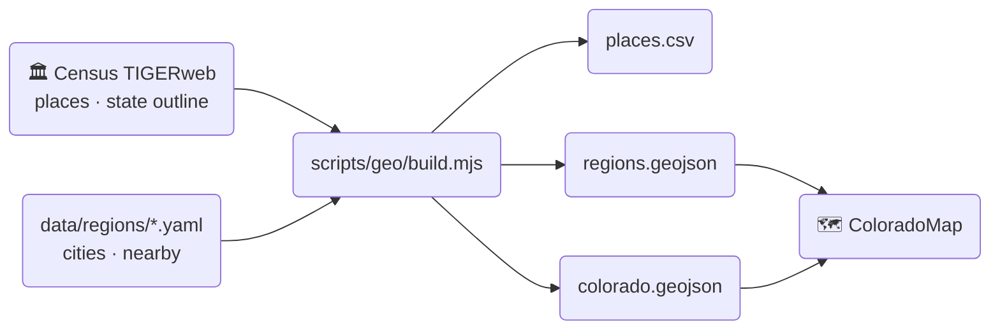

# Colorado geography for the site's maps

Built by [`scripts/geo/build.mjs`](../../scripts/geo/build.mjs). Do not edit these files by hand: change `data/regions/*.yaml`, then run the script.

| File | Holds | From |
| --- | --- | --- |
| `places.csv` | 485 Colorado places (incorporated places and CDPs): GEOID, name, kind, interior point | TIGERweb layers 4 and 5 |
| `colorado.geojson` | The state outline, simplified to 0.01° | TIGERweb `State_County` layer 0 |
| `regions.geojson` | One zone per region, plus its core cities | `places.csv` and `data/regions/*.yaml` |

## How a zone is drawn

| Step | Rule |
| --- | --- |
| 1 | Take the region's `cities` and `nearby` towns |
| 2 | Find each town's Census place: incorporated place first, then CDP; `ALIASES` maps local names, such as Cascade to Cascade-Chipita Park |
| 3 | Draw a 5 km circle around each point, and take the convex hull |
| 4 | Fail if a town has no place or two zones overlap |

A zone is **a proposal, not a legal line**. Census boundaries are statistical, not jurisdictional.

## Checks

| Command | Does |
| --- | --- |
| `node scripts/geo/build.mjs --check` | Offline: rebuilds `regions.geojson` from the committed files and fails on drift |
| `node scripts/geo/build.mjs --self-test` | Known-good and known-bad geometry samples |
| `site/test/unit/geo/regions-geo.test.ts` | The same drift check in CI, plus containment, overlap and outline bounds |

## License and credit

US Census Bureau data is not copyrighted (17 U.S.C. §105), and the Bureau asks to be credited: **Source: US Census Bureau, TIGERweb.** These derived files are CC0 1.0. No OpenStreetMap data is stored here. The basemap that `ColoradoMap` draws on is OpenFreeMap (© OpenMapTiles, data © OpenStreetMap contributors), and it is credited on the map itself.
