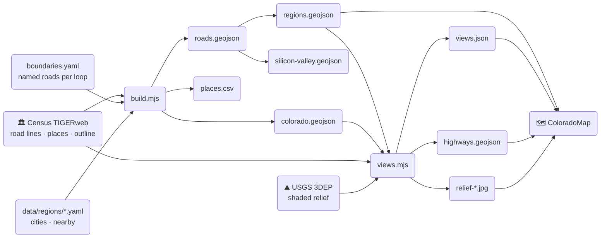

# Colorado geography for the site's maps

Built by [`scripts/geo/build.mjs`](../../scripts/geo/build.mjs) and [`scripts/geo/views.mjs`](../../scripts/geo/views.mjs). Do not edit the built files by hand: change [`boundaries.yaml`](boundaries.yaml) or `data/regions/*.yaml`, then run the scripts.

## The loops

Cities sit on the corners. Major roads between them are the edges. Each loop is about Silicon Valley's size (Paul, 2026-11-15). Sizes are measured from the Census road lines, 2026-11-15; one block is 10 sq mi.

| Loop | Roads | Area | Widest span | |
| --- | --- | --- | --- | --- |
| Silicon Valley, the yardstick | US-101 · I-280 · CA-84 | 95 sq mi | 22.5 mi | ▇▇▇▇▇▇▇▇▇▇ |
| Space Peak | I-25 · Interquest Pkwy · Powers Blvd · Mesa Ridge Pkwy · US-85 | 89 sq mi | 22.7 mi | ▇▇▇▇▇▇▇▇▇ |
| Fusion Canyon | US-287 · CO-14 · CO-257 · US-34 | 113 sq mi | 16.7 mi | ▇▇▇▇▇▇▇▇▇▇▇ |
| Photon Mountain | CO-93 and Broadway · Pearl · Foothills Pkwy · US-36 · I-25 · Park Ave West · Broadway · 6th Ave and US-6 | 170 sq mi | 25.4 mi | ▇▇▇▇▇▇▇▇▇▇▇▇▇▇▇▇▇ |

Photon Mountain's eight roads are the ones its own corridor map locked ([photon-mountain `MAP_NOTES.md`](https://github.com/Colorado-Startups/photon-mountain/blob/main/03_deliverables/maps/MAP_NOTES.md)). A zone is **a proposal, not a legal line**.

## Files

| File | Holds | From |
| --- | --- | --- |
| `boundaries.yaml` | Each loop's roads, in order, by hand | Paul's rule above |
| `roads.geojson` | One traced line per road | TIGERweb Transportation layers 2, 6 and 8 |
| `regions.geojson` | One zone per region: its loop, cities, town dots and size | `roads.geojson`, `data/regions/*.yaml`, `places.csv`, [`data/positions/geo.yaml`](../positions/geo.yaml) |
| `silicon-valley.geojson` | The yardstick loop and its size | `roads.geojson` |
| `places.csv` | 485 Colorado places (incorporated places and CDPs): GEOID, name, kind, interior point | TIGERweb layers 4 and 5 |
| `colorado.geojson` | The state outline, simplified to 0.01° | TIGERweb `State_County` layer 0 |
| `views.json` | Each map view's frame, in Web Mercator: the state, one zoomed view and one 16:9 thumbnail per region | `regions.geojson`, `colorado.geojson` |
| `highways.geojson` | The numbered highways inside each view | TIGERweb Transportation layers 0 and 3 (state), 2 and 6 (regions) |
| [`site/src/assets/maps/relief-*.jpg`](../../site/src/assets/maps/) | A grey shaded relief that fills each view's frame | USGS 3DEP `Hillshade Gray` |

## How a map is drawn

| Layer | Made by | Shows |
| --- | --- | --- |
| Relief image | `views.mjs`, lazy-loaded | Mountains and plains, tinted by the page's own colors |
| Drawing, no JavaScript | [`colorado-map.ts`](../../site/src/lib/regions/colorado-map.ts) | Highways, interstate shields and two peaks statewide; each zone's line with its roads named, cities, a mile bar |
| Live map, on demand | [`colorado-map.client.ts`](../../site/src/components/map/colorado-map.client.ts) | MapLibre over OpenFreeMap with Mapterhorn relief, behind "Explore the live map" |

Every view is Web Mercator, so the three layers line up.

## A map as one file

| File | Shows |
| --- | --- |
| [`/maps/colorado.svg`](https://coloradostartups.org/maps/colorado.svg) | The state and the three regions |
| [`/maps/photon-mountain.svg`](https://coloradostartups.org/maps/photon-mountain.svg) · [`fusion-canyon.svg`](https://coloradostartups.org/maps/fusion-canyon.svg) · [`space-peak.svg`](https://coloradostartups.org/maps/space-peak.svg) | One region, its roads named |

Each is the relief and the drawing in one standalone SVG, built with the site by [`map-file.ts`](../../site/src/lib/regions/map-file.ts). A README shows one with an image tag, and it follows the zones.

## How a loop is traced

| Step | Rule |
| --- | --- |
| 1 | Fetch the Census lines that carry each road's names |
| 2 | Find where each road meets the next: their closest points, within 3 km of the `to` hint |
| 3 | Follow each road between its two junctions by the shortest way along its own lines |
| 4 | Bridge a gap the lines leave, such as an interchange, with a straight stitch of 500 m at most |
| 5 | Close the ring and drop every bend under 10 m |

## What fails the build

| Check | Limit |
| --- | --- |
| Two roads do not meet, or a road does not connect its junctions | 500 m |
| A loop crosses itself, or two zones overlap | never |
| A city sits off its loop | 3 miles outside the line |
| A loop is the wrong size | 0.75 to 2 times Silicon Valley's area |
| A town has no centre and no Census place | never |

## When a loop changes

This repo holds the loops. Six other places show them, and two of the six follow on their own.

| # | Where | Follows on its own | Do |
| --- | --- | --- | --- |
| 1 | This repo | no | Edit [`boundaries.yaml`](boundaries.yaml) or `data/regions/*.yaml`. Run `build.mjs --roads`, then `views.mjs` |
| 2 | The site's maps and [`/maps/*.svg`](https://coloradostartups.org/maps/colorado.svg) | yes, on deploy | Nothing |
| 3 | The map image in each README: this repo, the [org profile](https://github.com/Colorado-Startups/.github), the three region repos | yes, it is `/maps/*.svg` | Nothing |
| 4 | [`brand`](https://github.com/Colorado-Startups/brand) `data/world.yaml` | no | Each region's `plain_label` lists its cities |
| 5 | [`fusion-canyon`](https://github.com/Colorado-Startups/fusion-canyon) `03_deliverables/map/fusion_canyon_corridor.geojson` | no | Copy the loop in, with this repo's commit in `source_url` and `coord_detail` |
| 6 | [`space-peak`](https://github.com/Colorado-Startups/space-peak) `04_tools/space_peak_map.py` | no | Set `WEBSITE_COMMIT`, and the same commit in `.github/workflows/ci.yml`. Rebuild |
| 7 | [`photon-mountain`](https://github.com/Colorado-Startups/photon-mountain) `03_deliverables/maps/` | no | Its ring is its own OpenStreetMap trace. Update the facts panel's figures and `MAP_NOTES.md` |

## Commands

| Command | Does |
| --- | --- |
| `node scripts/geo/build.mjs --roads` | Fetches and traces the roads, then rebuilds the zones and the yardstick. Prints each loop's size |
| `node scripts/geo/build.mjs --check` | Offline: rebuilds the zones and the yardstick from the committed files and fails on drift |
| `node scripts/geo/build.mjs --self-test` | Known-good and known-bad geometry samples |
| `node scripts/geo/build.mjs` | Also refetches `places.csv` and `colorado.geojson` |
| `node scripts/geo/views.mjs` | Fetches each view's highways and relief image. Run it after the zones change |
| `node scripts/geo/views.mjs --check` | Offline: fails when `views.json` no longer matches the zones |
| `site/test/unit/geo/regions-geo.test.ts` | The same checks in CI |

## License and credit

| Data | Source | Terms |
| --- | --- | --- |
| Roads, places, outline | US Census Bureau, TIGERweb | Not copyrighted (17 U.S.C. §105). The Bureau asks to be credited |
| City centres | USGS GNIS, in `data/positions/geo.yaml` | Public domain |
| Relief images | USGS 3D Elevation Program | Public domain. USGS asks to be credited |
| These derived files | Colorado Startups | CC0 1.0 |

No OpenStreetMap data is stored here. The live map's basemap is OpenFreeMap (© OpenMapTiles, data © OpenStreetMap contributors) and its relief is Mapterhorn; both are fetched in the browser and credited on the map itself.
