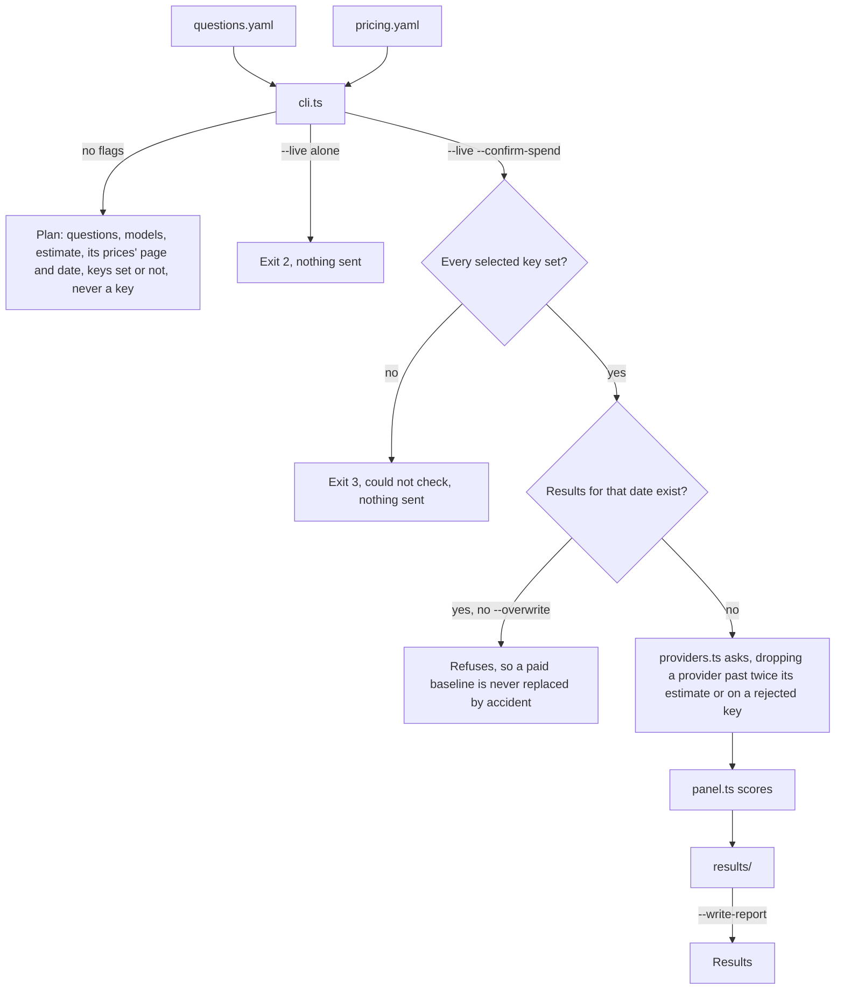
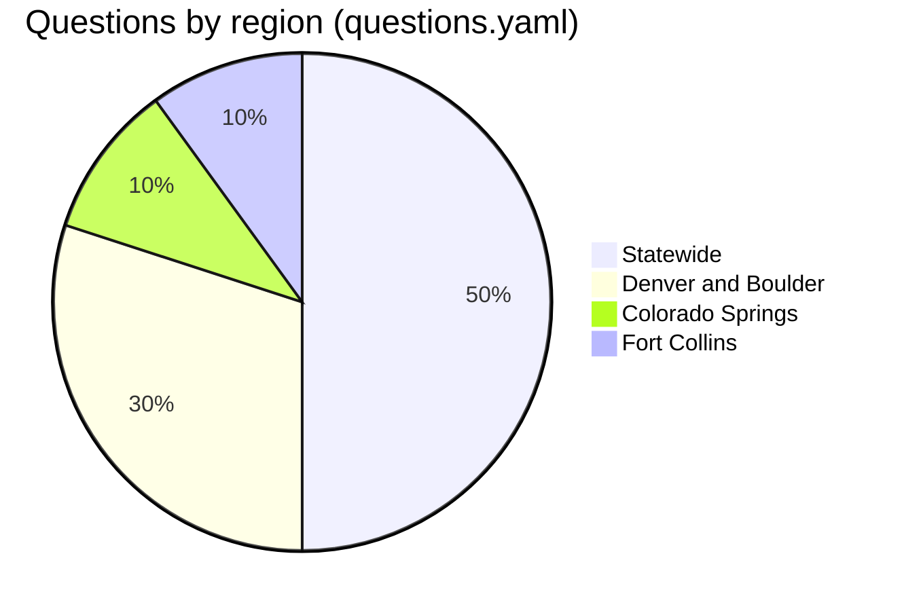

# AI-visibility panel: the method

*How [the panel](REPORT.md) runs, what it asks and what it measures. Providers, spend, decisions and limits: [`PROVIDERS.md`](PROVIDERS.md).*

## What it asks

| Topic ([questions.yaml](questions.yaml): 20, a goal count) | Questions | Ids |
| --- | --- | --- |
| community | 3 | v01 to v03 |
| founders (meeting other founders) | 3 | v04 to v06 |
| resources and programs | 2 | v07, v08 |
| lookup (Startup Resources-style) | 3 | v09 to v11 |
| accelerators by city | 4 | v12 to v15 |
| region | 2 | v16, v17 |
| events | 3 | v18 to v20 |

| Rule | Held by |
| --- | --- |
| Phrased as people type. None names Colorado Startups, coloradostartups.org or another organization, or says "Colorado startups" | `parseQuestions()` refuses; `test/questions.test.ts` checks |
| Ids stay fixed so months compare. To change a question, add a new id, run both a month, then retire the old one | Review |

## What is measured

| Measure | Definition |
| --- | --- |
| Recorded | Per answer: full text, every cited URL, every URL its searches returned, stop reason, usage block, cost |
| Named | The text says "Colorado Startups" (case-sensitive), "ColoradoStartups", or coloradostartups.org in prose or in one of our own URLs. Lowercase "Colorado startups" is the generic phrase answers use constantly |
| Cited | The provider's citation list, or a link or bare domain in the text, points at coloradostartups.org or a subdomain. |
| Position | Where the first mention sits: its character offset, its share of the text, and its rank among the things the answer lists. |
| Rank | Among top-level list items, else headings, else paragraphs ([`locate()`](panel.ts)); nested bullets stay in their parent. A lead mention ranks 1. A mention between units ranks after the one before it, so a closing "you can also try" ranks last |
| Named first | The first mention ranks 1. |
| Output | `results/<date>-<provider>.json` per provider; `results/<date>-summary.md` with the provider table, question grid, most-cited domains and real cost. The date is Denver's, so an evening run files under the right day. Every mention keeps its context for a person to check |

