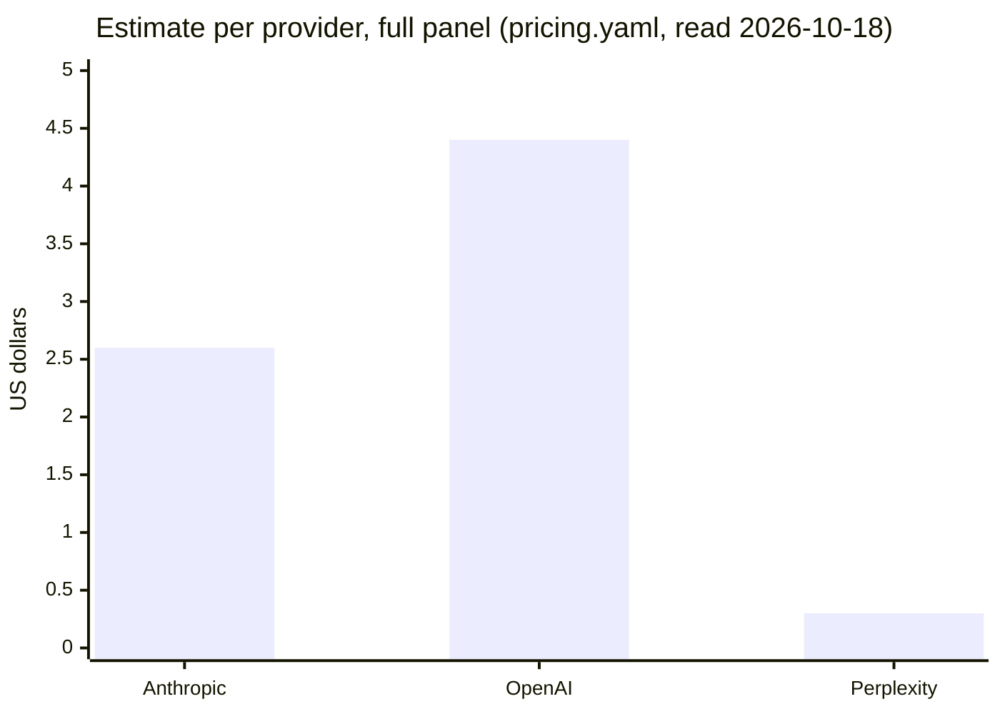

# AI-visibility panel: providers, spend and limits

*For [the panel](REPORT.md) and its [estimate](REPORT.md#spend); the method: [`METHOD.md`](METHOD.md).*

## Who it asks

| Provider | API | Model ([pricing.yaml](pricing.yaml)) | Search | Key variable |
| --- | --- | --- | --- | --- |
| anthropic | Messages API | `claude-sonnet-5-5` | `web_search_20260209`, `max_uses` 5 | `ANTHROPIC_API_KEY` (registry row `API-Key-Anthropic-AIVisibility`) |
| openai | Responses API | `gpt-5.5` | `web_search` tool, sources included | `OPENAI_API_KEY` (vendor's name; no registry row yet) |
| perplexity | Sonar API (`/v1/sonar`) | `sonar` | built in | `PERPLEXITY_API_KEY` (vendor's name; no registry row yet) |
| Request shapes | Each provider's docs, read 2026-10-18, named atop [providers.ts](providers.ts) | | | Registry `API-Keys/keys.toml`, Colorado-Startups/compute (`keys.sh list`, 2026-11-03) |

## Spend gate and cost

| Rule | Detail |
| --- | --- |
| Basis | Each pricing page's prices (read 2026-10-18) times assumed per-question token and search counts |
| Real cost | Each live run's summary shows it beside the estimate, from the usage blocks |
| Keys | Environment variables only, never written, scrubbed from error text. Tests grep every written file for their fake keys |
| 401 or 403 | Records only `HTTP <status>`, never the body: OpenAI's 401 body echoes a masked key (`sk-proj-****abcd`) the exact-key scrub misses. `test/auth-errors.test.ts` serves it from every provider at both and fails if any reaches a results file or the log |

## Decisions in this lane

| Decision | Why | To reverse |
| --- | --- | --- |
| Plain fetch, not vendor SDKs | Neither SDK is installed; the lockfile is the orchestrator's. One HTTP layer serves all three and replays recorded responses in tests | Add `@anthropic-ai/sdk` at the root; swap `anthropic.ask()`'s body |
| No refusal fallback on Anthropic | A fallback answers with another model, so a refusal is a result | Add `fallbacks` and its beta header in `providers.ts` |
| `gpt-5.5` for OpenAI | OpenAI's web search guide (2026-10-18) recommends it for new Responses integrations | Edit `model` and prices in `pricing.yaml` |
| No user location | Questions name their cities; Perplexity's field was not in the docs read; the providers stay alike | Add `user_location` per provider |
| A lead mention ranks first | The answer put it ahead of everything it lists | One line in `locate()` |
| Node runs the TypeScript directly (Node 26 type stripping) | No build step; `evals/resourcus/` bundles, as it imports Worker modules | n/a |

## Known limits

| Limit | Read it as |
| --- | --- |
| API answers are not app answers | The apps add system prompts, memory, location and model choices. The same API question monthly makes months comparable: a proxy, not a copy |
| One sample per question | Answers vary: one or two changes are noise; look for movement across months and providers |
| Training data is not measured | A search-off mode would show what each model knows |
| Title-case false positive | A heading "Top Colorado Startups To Watch" counts. Questions avoid the phrase, keeping it rare |
| Perplexity's search context size | A response without it is charged the high request fee (`pricing.yaml`) |
| Prices drift | Re-read the three pricing pages before a run that matters; update `pricing.yaml` and its date |
