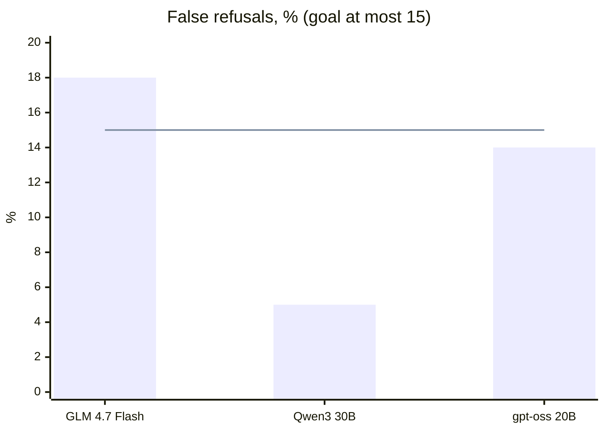
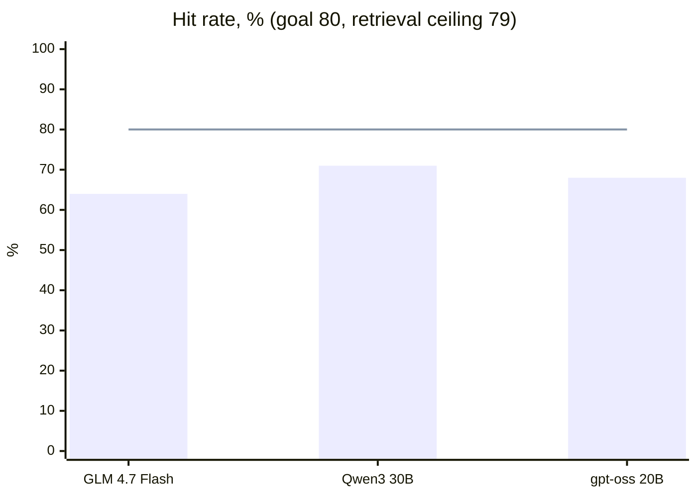

# Resourcus model choice

- [x] First live run, 2026-10-08, on `resourcus-staging` with L3's 545 active records. No model met every goal.
- [x] The site runs `@cf/qwen/qwen3-30b-a3b-fp8`, provisionally (`RESOURCUS_MODEL` in [model.ts](../../site/worker/resourcus/model.ts)); [Recommendation](#recommendation) says why. Method: [`METHOD.md`](METHOD.md); running it, checks and limits: [`RUNNING.md`](RUNNING.md).
- [ ] Hand-checked `ids:` for each answerable question, then a rerun.

## Results

<!-- results:start -->
Run: 2026-10-09 01:48 UTC, live, resourcus-staging, corpus data/resources (545 active) [e62b593d].
Kinds on this corpus: 28 answerable, 2 no-match, 10 should refuse.

| Model | Citation precision | Hit rate | Groundedness | Correct refusals | Honest no-match | False refusals | Errors | Leaks | Retrieval recall | Median latency |
| --- | --- | --- | --- | --- | --- | --- | --- | --- | --- | --- |
| `@cf/zai-org/glm-4.7-flash` | 75% | 64% | 97% | 100% | 100% | 18% | 0% | 0 | 12% | 901 ms |
| `@cf/qwen/qwen3-30b-a3b-fp8` | 72% | 71% | 100% | 100% | 100% | 5% | 0% | 0 | 12% | 591 ms |
| `@cf/openai/gpt-oss-20b` | 79% | 68% | 100% | 100% | 100% | 14% | 0% | 0 | 12% | 713 ms |

Recommended by the harness: none yet. No live model has met every goal in this run.
<!-- results:end -->

## Recommendation

**Run Qwen3 30B (`@cf/qwen/qwen3-30b-a3b-fp8`), provisionally.** The harness picks only a model meeting every goal; none did, so this is the orchestrator's call (decision 41).

Source: the Results block (run 2026-10-09 01:48 UTC) and `results/2026-10-09-*.json`.

| Who leads: Qwen3 against | False refusals | Hit rate | Groundedness | Speed | Citation precision |
| --- | --- | --- | --- | --- | --- |
| GLM 4.7 Flash, the old default | Qwen3; GLM misses the goal | Qwen3 | Qwen3 | Qwen3 | GLM by 3 points, its only edge |
| gpt-oss 20B | Qwen3 | Qwen3 | Tie: both full, both refuse every unsafe question | Qwen3 | gpt-oss; the weaker signal, as specs are broad |

| Finding | Detail |
| --- | --- |
| What holds every model back | Retrieval and the specs, not generation. AI Search found an expected resource for 22 of 28 answerable questions: a hit-rate ceiling of 79%, under the 80% goal. Qwen3 and gpt-oss each hit 20 of those 22 |
| Recall reads 12%, per the results | Specs expect dozens of resources per question (q01 expects 76); retrieval returns six |
| Next | A person writes `ids:` from the real Canvas, replacing the broad specs. Then rerun `run.mjs --live --write-report --check` (retrieval stays cached, so only generations are paid) and revisit this pick |

