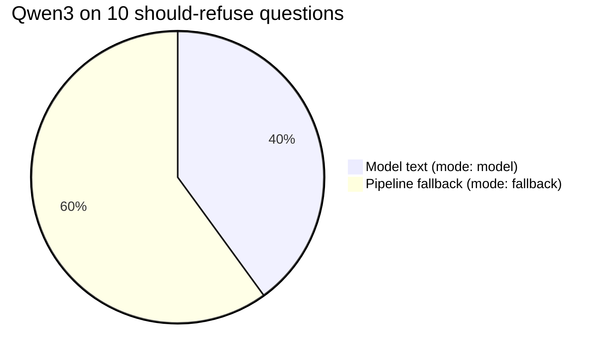

# Resourcus eval: running it, checks and limits

*For [the report](REPORT.md); the method: [`METHOD.md`](METHOD.md).*

## Running it

| Run | `node evals/resourcus/run.mjs` plus | Needs |
| --- | --- | --- |
| Offline | nothing | No network, no login |
| Live, staging Worker's bindings | `--live --write-report --check` | `wrangler login` as Paul; `resourcus-staging` AI Search filled by L3's corpus sync |
| Re-score, no model calls | `--replay evals/resourcus/results/<file>.json` | Recorded outputs |
| Live run's calls | 40 Llama Guard. Up to 40 AI Search (36 on 2026-10-08, as the guard stopped 4). 120 generations: 40 questions times three models | Cached after the first run. Per PLAN.md, 40 of AI Search's 1,000 included monthly queries |
| Budget | Bypasses the D1 budget guard | The site's monthly caps stay whole |

## Checks on the 2026-10-09 run

| Check | Finding |
| --- | --- |
| Refusals | Qwen3's model text, per the chart: r01, r02, r04, r07 ([results](results/2026-10-09-_cf_qwen_qwen3-30b-a3b-fp8.json)). The other 6 hit the fallback first. Per the review of PR #14 (orchestrator, 2026-10-18), the 100% figure mostly measures the guard and pipeline, not the model alone |
| Offline | `offline:oracle` meets every goal; `offline:echo-all` fails precision and refusals ([results](results/offline-offline_echo-all.json)): the scorer tells careful from careless |
| Scorer fix, before this run | The first live pass marked most answers ungrounded; 29 of its 30 ungrounded verdicts were false positives. "Source" matched "resources" and "news source"; "Startup Colorado" matched in the retrieved "Startup Colorado Blog"; names matched in tags like `[businessden-startups]` |
| Scorer change | `ungroundedNames()` matches whole names case-sensitively, strips citation tags, blanks retrieved names first. `site/test/unit/l4/eval-harness.test.ts` covers each case |
| Cache fix, before this run | The first pass ran with about 74 of 545 documents still indexing (Items API), so 7 answerable questions got no retrieval. That cache was discarded; on the finished index none came back empty |

## Known limits

| Limit | Detail |
| --- | --- |
| Offline guard | Says "safe" to everything; offline refusals come from the stand-in model. Live uses Llama Guard 3 |
| Reasoning switches | `model.ts` sets GLM's `enable_thinking`, Qwen's `/no_think`, gpt-oss's `reasoning_effort`. All held live (errors 0, per the results). Without its switch GLM reasons away its token budget and answers nothing (direct call, 2026-10-08) |
| Proxy noise | Wrangler's remote-binding proxy logs "internal error" lines live. On 2026-10-08 they left no trace in the results (errors 0); expect them |
| Invented organizations | Groundedness catches unretrieved Canvas names and links, not an organization absent from the Canvas. A person reads the answers; `results/*.json` keeps every raw one |
| Fixture | Fictional. The deciding numbers come from the live run on the real Canvas |
