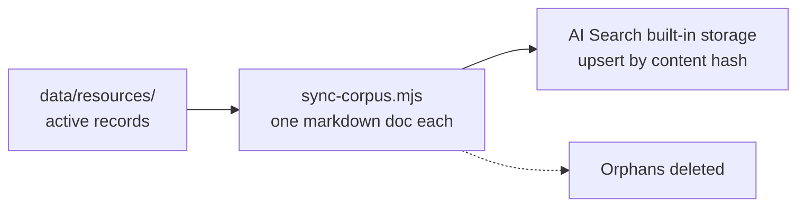

# scripts/canvas

Tools that check resource links and keep the Resourcus corpus in step with [`data/resources/`](../../data/resources/). Owner: L3. Everything here runs on a person's machine. Nothing here runs in a Worker or in CI with credentials.

| Script | What it does | Network |
| --- | --- | --- |
| [`check-links.mjs`](check-links.mjs) | Checks suggested links, or every record's link with `--records`, and lists what needs a look; changes no file | Status checks only |
| [`sync-corpus.mjs`](sync-corpus.mjs) | Uploads one markdown document per active resource to the AI Search instance's built-in storage, upserts by content hash and deletes orphans | Only without `--dry-run`, with Paul's token |
| [`lib/`](lib/) | The pieces the scripts use; unit-tested in [`site/test/unit/l3/`](../../site/test/unit/l3/) | |

## The Canvas importer is retired

The import that turned the Ecosystem Canvas Google Doc into `data/resources/` is gone (decision [92](https://github.com/Colorado-Startups/coloradostartups-site/blob/25a00d88d28a9a0895ac1e57d58e2ef4d21e6d09/00_project_system/decisions.md#L195)). The records it wrote stay. Change a record by hand, in a pull request. The canvas review in the private archive is edited by hand too.

On 2026-11-02, 108 of the 608 records in `data/resources/` still carry a template line (`grep -rl "Listed in the Ecosystem Canvas" data/resources`).

## Sync the Resourcus corpus



See the header of [`sync-corpus.mjs`](sync-corpus.mjs). A dry run needs no credentials:

```bash
node scripts/canvas/sync-corpus.mjs resourcus-staging --dry-run
```
