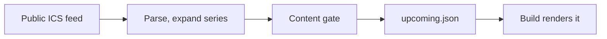

# Events on /event-calendar/

*Owner L24. Crawlers cannot read the Google Calendar iframe, so the build writes the next 60 days as HTML above it, with `Event` JSON-LD for in-person events.*

## How it flows

| Step | File | What happens |
| --- | --- | --- |
| 1 | [`fetch-ics.mjs`](fetch-ics.mjs) | Reads the feed, whose URL `CALENDAR_ID` fixes in [`links.ts`](../../site/src/components/info/links.ts); it takes no URL. |
| 2 | [`lib/ics.mjs`](lib/ics.mjs), [`lib/events.mjs`](lib/events.mjs) | Expands recurring series (weekly, every other week, "second Thursday", "last Thursday", COUNT, UNTIL). Drops EXDATEs, cancelled and private events; swaps in moved instances. |
| 3 | [`lib/lint.mjs`](lib/lint.mjs) | Lints each title, location, link and description with [`cs_site_lint.py`](../../04_tools/cs_site_lint.py), the hooks' and CI's gate. Any term-rule finding (FAIL or WARN), or a prose FAIL in the shown title or location, keeps the event off the page. The log names the rule. |
| 4 | [`data/events/upcoming.json`](../../data/events/) | The snapshot |
| 5 | [`site/src/components/events/`](../../site/src/components/events/) | At build time keeps what has not ended, rendered in Mountain Time. |

## When it runs

| Where | What happens |
| --- | --- |
| Workers Builds (`WORKERS_CI=1`) | The prebuild fetches the feed and rewrites the snapshot, so the deployed page is fresh. |
| A local `npm run build`, GitHub Actions. | The prebuild lists the committed snapshot: builds stay offline, tests repeatable. |
| `CS_EVENTS_FETCH=1 npm run build` | Fetches, like Workers Builds; every hand build for production sets it (decision [91](https://github.com/Colorado-Startups/coloradostartups-site/blob/25a00d88d28a9a0895ac1e57d58e2ef4d21e6d09/00_project_system/decisions.md#L160)) |
| `node scripts/events/fetch-ics.mjs` | Rewrites the committed snapshot; commit it for a fresher repo copy. |

| Exit | Means |
| --- | --- |
| `0` | Written, or skipped in `--prebuild` |
| `2`, `3` | Usage error; could not check (the feed, the parser or the gate failed), and the snapshot stays as it was. |
| The build | Wraps the script in `\|\| true`: fail open for the build, fail closed for the content, since text the gate has not read never reaches the page. |

## Freshness needs a scheduled rebuild

*As fresh as the last build: a week with no merges drops past events and adds no new ones.*

| Fact | Source |
| --- | --- |
| No daily rebuild is set up. | No workflow has a `schedule:` trigger (`git grep -n "schedule:" -- .github/workflows`, 2026-11-02) |
| Production deploys on each green merge, from `production`, since 2026-11-03; it and every hand build fetch the feed. | the Workers Builds runbook (private archive); decisions 70, [72](https://github.com/Colorado-Startups/coloradostartups-site/blob/25a00d88d28a9a0895ac1e57d58e2ef4d21e6d09/00_project_system/decisions.md#L116), 91. |
| The 2026-11-02 deploy fetched 65 events; the page listed dates through 2026-12-31. | `fetchedAt` 2026-11-02T23:50:57Z in `upcoming.json`; `curl` of `/event-calendar/`, 2026-11-02. |
| Before it, the page stopped at 2026-12-17, the 2026-10-19 snapshot's window. | [#396](https://github.com/Colorado-Startups/coloradostartups-site/issues/396) |

- [ ] Paul approves the daily trigger and the deploy hook. The hook URL works as a credential; a daily trigger is new scheduled work (`delegation.md`, Paul's queue).
- [x] The `production` branch for Workers Builds (decision [70](https://github.com/Colorado-Startups/coloradostartups-site/blob/25a00d88d28a9a0895ac1e57d58e2ef4d21e6d09/00_project_system/decisions.md#L114)), done 2026-11-03.
- [ ] Cloudflare: the site's Worker > Settings > Builds > Deploy Hooks, a hook for `production` (Cloudflare changelog, 2026-04-01).
- [ ] POST it daily, from a Worker cron or a scheduled Action; the URL lives in a secret store, never this repo.
