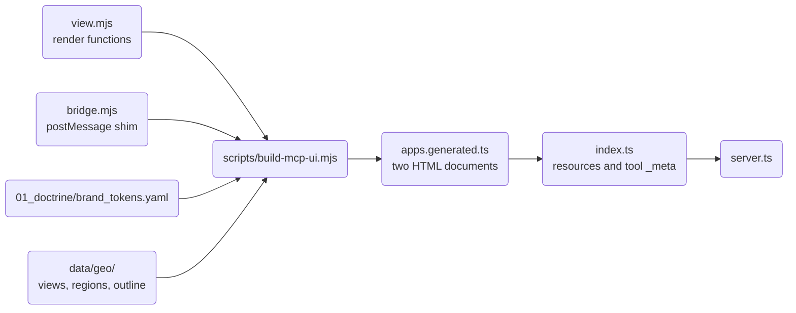

# MCP Apps cards for /mcp

A host that supports MCP Apps (Claude, VS Code, Goose) shows a small card when `this_week` or `region` answers. Every other host gets the same text result as before.

| File | Holds | Edit by hand |
| --- | --- | --- |
| `view.mjs` | `renderWeek` and `renderRegion`: a tool result in, escaped HTML out | Yes |
| `bridge.mjs` | The View side of the protocol: `ui/initialize`, tool results, theme, `ui/open-link`, size | Yes |
| `index.ts` | The two `ui://coloradostartups/...` resources and `uiToolMeta` | Yes |
| `apps.generated.ts` | Both cards as HTML strings | No: run `node scripts/build-mcp-ui.mjs` in `site/` |

| Rule | Where it is checked |
| --- | --- |
| Generated file matches its sources | `test/unit/mcp/ui.test.ts` regenerates it in memory |
| Colors, spacing and radii equal the brand tokens, light and night | `test/unit/mcp/ui.test.ts` |
| Each card under 40 KB, ASCII only, no outside load or fetch | The generator throws; both test files check |
| Text results unchanged, `_meta.ui` on two tools only | `test/worker/mcp/mcp.test.ts` |

The generator runs on `predev` and `prebuild`, after `sync-brand.mjs`. The spec is MCP Apps 2026-01-26 ([`apps.mdx`](https://github.com/modelcontextprotocol/ext-apps/blob/v2.1.0/specification/2026-01-26/apps.mdx)). The official View library bundles to 546 KB, so `bridge.mjs` implements the few messages the cards use and quotes the spec for each.
